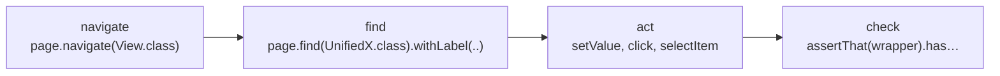

# Developer guide

How to write Unified UI Tests, by example. The [Specification](../spec/README.md) says what the Unified API guarantees and why; this guide shows how to use it. The [API reference](../../unified-test-api/src/main/resources/META-INF/unified/api-reference.md) lists every Wrapper with its filters, actions, reads and checks.

The examples are included from [`unified-test-demo`](https://github.com/parttio/unified-testing-tool/tree/main/unified-test-demo/src/test/java/demo): most from its tests, which run in CI on every Testing Tool, and the short ones from `GuideExamples`, which CI compiles. So they can't go out of date.

## Your first test

[Getting started](getting-started.md) goes from the dependencies to a test that passes on Browserless and in a browser:

```java
--8<-- "unified-test-demo/src/test/java/demo/ProfileViewTest.java:savesName"
```

## Four steps in every test



| Step | API | Guide page |
|---|---|---|
| Open a view | `page.navigate(View.class)` | [Navigation, users and windows](navigation-and-users.md) |
| Find a component | `page.find(Wrapper.class)` and its filters: it returns the Wrapper | [Finding components](finding-components.md) |
| Act on it | the wrapper's methods: `setValue`, `click`, `selectItem`, … | [Working with components](components.md), [Grid](grid.md) |
| Check the result | `assertThat(wrapper)`, also `exists()`, `doesNotExist()`, `hasCount(n)` | [Assertions and waiting](assertions-and-waiting.md) |

Every action and assertion is reported as a User Step, in the user's words. The rest of the guide, by what you are doing:

- **Get started:** [Getting started](getting-started.md): the dependencies, a first test, running it on each Testing Tool, and reading its failure.
- **Write:** the four steps above, and
    - [Structuring a scenario](structuring-a-scenario.md): `@DisplayName`, given/when/then, User Tasks with `page.step(..)`, page objects;
    - [Common mistakes](common-mistakes.md): code to look for in a test, and what to write instead.
- **Read and review:**
    - [Reading reports and failures](reports-and-failures.md): the CI log, `user-steps.txt`, the run summary, the failure message with its Near Misses;
    - [Reviewing a test](reviewing-tests.md): what to read, in order, and a checklist for a test a colleague or an agent wrote;
    - [Troubleshooting](troubleshooting.md): what a failure, a skip or a setup error says, its likely cause and the fix.
- **Run:**
    - [Running in CI](ci-setup.md): a GitHub Actions workflow that puts the run summary on the job's page, and the setup for other CI servers;
    - [Configuration](configuration.md): every setting, from the Testing Tool and the timeout to the reports and each Testing Tool's browser.
- **Extend:**
    - [When a test needs one Testing Tool](tool-specific.md): the Escape Hatch, `@RequiresBrowser`, `@RequiresTestingTool`;
    - [Wrappers for your own components](custom-wrappers.md): add-ons, custom components, custom filters;
    - [Checking the style](style-rules.md): scenario sentences, no raw waits and `@RequiresTestingTool`, checked by a test.
- **For agents:** [For agents](for-agents.md): the skill, the API reference in the jar, `llms.txt`, and how to check what an agent did.
- **Maintain:** [Benchmarking the Unified layer](performance-benchmark.md): for contributors to the Unified API, the round-trip check and the time benchmark that compare Unified UI Tests with Direct Tests.

## Running it in a browser

The same test runs in a real browser when the run says so (`-Dvaadin.testing.tool=playwright` or `selenium`); [Running in CI](ci-setup.md) shows the jobs. Two things are set up for you:

- **The application is served in development mode**, with the frontend bundle that ships with `vaadin-dev`, so a browser run needs no frontend build first.
- **Vaadin's development tools are off** *(unreleased)* in a `@UnifiedSpringBootTest`'s application (`vaadin.devmode.devTools.enabled=false`). A test needs neither Copilot nor the tools' overlay, and with them on, Copilot starts file watchers for every browser session and keeps them until the application stops, which runs a long test run out of them. To have the tools in a test, set the property yourself; anything that sets it wins over this default:

```java
@UnifiedSpringBootTest(properties = "vaadin.devmode.devTools.enabled=true")
```

## For agents

The `write-unified-ui-tests` skill, the API reference in the jar, `llms.txt` and what an agent reads after a run: [For agents](for-agents.md).

## Rules of thumb

--8<-- "docs/snippets/rules-of-thumb.md"
