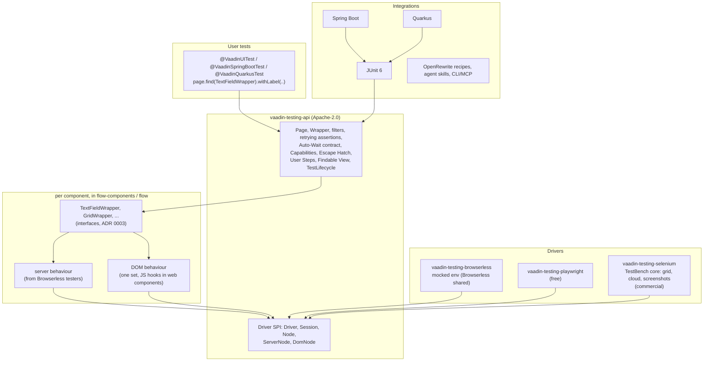

# Merging Vaadin's testing tools: duplication measured, options, and an architecture for one official testing API

Background research. It does not belong to a single ticket. It builds on [selenium-vs-playwright-for-vaadin.md](selenium-vs-playwright-for-vaadin.md) (cited as "S-vs-P T6", "S-vs-P D4" and so on), [web-framework-testing-landscape.md](web-framework-testing-landscape.md) ("landscape B1"), [agentic-testing-environment-roadmap.md](agentic-testing-environment-roadmap.md) ("roadmap C4") and this repo's ADRs, and does not repeat them. The S-vs-P note already answered "Selenium or Playwright, and should Vaadin adopt Dramafinder" (its recommendation: adopt Dramafinder now, converge later on one API with several backends). This note goes one level down: what the three tools are made of, how much of that is the same work done several times, and what one official product would look like.

**Question** (from a Vaadin engineer). Does it make sense to merge the three testing tools (TestBench, Browserless Test, Dramafinder) into one library and move them? What is the code duplication? Suggest a new architecture for the testing API. How can Vaadin change its testing story as an official product?

Researched 2026-11-24 against these checkouts. All five clones are shallow, so commit history was used only where it is in the clone (the last few weeks).

| Repository | Commit | State |
|---|---|---|
| `vaadin/testbench` | `4e1c923` (2026-11-24) | `25.5-SNAPSHOT`, Selenium 4.53.0, Flow `25.5-SNAPSHOT` (`pom.xml` L13, L36, L42) |
| `vaadin/browserless-test` | `f69a50d` (2026-11-24) | `25.5-SNAPSHOT`, Flow and components `25.5-SNAPSHOT` (`pom.xml` L14, L39–40) |
| `parttio/dramafinder` | `f3c30db` (2026-11-24, right after releasing 2.2.2) | `2.2.3-SNAPSHOT`, built on Vaadin 25.3.0 and Playwright 1.63.0 (`pom.xml` L7, L24, L92–94) |
| `parttio/unified-testing-tool` | `fdbe120` (2026-11-24) | `0.1.0-SNAPSHOT`, last release `0.1.0-alpha5` (`README.md` L57) |
| `vaadin/flow-components` | `d1a42ad` (2026-11-24) | sparse checkout of the 48 `*-testbench` modules only |
| `vaadin/flow` | `32e7f0a` (2026-11-24) | sparse checkout of `flow-html-components-testbench` only |

`flow-components` and `flow` were cloned because TestBench's component element classes do not live in `vaadin/testbench`: they ship next to each component (fact I3 below). Leaving them out would undercount TestBench by half.

Labels: a **fact** has a source (a file path with lines in the named repository at the commit above, a commit, or an earlier note's fact id). **[opinion]** marks this note's reasoning; the sections titled *Inferences* are opinion throughout. Measurements say how they were made ([How the numbers were measured](#how-the-numbers-were-measured)).

## Answer in short

1. **There are not three testing tools today but five component-wrapper libraries for one component set**, and about **63,000 lines** of main code whose only job is to know how to drive Vaadin's components: TestBench's elements in `flow-components` and `flow` (12,670 lines), TestBench's deprecated UI Unit testers (7,345), Browserless Test's testers (15,325), Dramafinder's elements (21,166) and the Unified API's Wrappers plus their three adapters (6,538). The 43 components that TestBench, Browserless and Dramafinder all cover are each implemented at least three times, with four vocabularies for the same act (`selectByText`, `selectItem`, `selectItem`, `selectItem` on a combo box). Grid alone is about 9,200 lines across the five.
2. **The largest single duplication is accidental and already decided: TestBench UI Unit and Browserless Test are a fork of each other.** 4,616 of TestBench UI Unit's 7,649 code lines (60 %) and 10,335 of its 11,574 test-code lines (89 %) occur unchanged in Browserless Test's same-named files. TestBench UI Unit is `@Deprecated(forRemoval = true)` in favour of Browserless, yet both still receive the same fixes: "run shortcut and click filters declared as JavaScript" landed in both repositories on 2026-11-13 (`testbench@0adbfbb`, `browserless-test@4930397`). Removing UI Unit is the cheapest win on the table. The fork also shows that Vaadin has already moved the in-JVM layer from commercial (UI Unit runs a licence check) to free (Browserless is Apache-2.0).
3. **The second-largest duplication is between the two browser libraries, and most of it is also accidental.** TestBench and Dramafinder both drive the *same web components in a browser*; only the wire protocol differs. Both restate each component's tag (86 `@Element`, 57 `@PlaywrightElement` annotations versus Flow's own `@Tag`), both embed the same Vaadin "is the server done?" script, and Grid's private web-component API (`_scrollToFlatIndex`, `_flatSize`, `_getColumns`, `_getRenderedRows`) is called from four separate copies of JavaScript (TestBench, Dramafinder, and both Unified browser adapters). Browserless versus the browser tools is the only *necessary* (conceptual) duplication: the server-side tree and the DOM really need different code.
4. **The Unified API proves one API over all three runtimes works, but it adds a fifth layer instead of removing one.** Its adapters sit on top of TestBench elements, Dramafinder elements and Browserless testers (each 2,475–2,703 lines), its SPI hard-codes per-component `*Access` interfaces (`GridAccess`, `LoginAccess`, … 330 lines), and the Selenium and Playwright adapters each carry their own version of the same component logic. It also had to file 36 gap issues against Dramafinder and two umbrella issues against TestBench and Browserless to make the tools behave alike (`docs/spec/appendix-gaps.md`).
5. **Recommendation [opinion]: merge, in stages, into one official product with one API and two kinds of runtime, not into one jar.** Keep separate artifacts and drivers (so Selenium and its licence stay optional), but give each component **one** wrapper interface (the Unified API's ADR 0003 shape) with exactly **two** behaviour implementations: a *server* one (Browserless) and a *DOM* one shared by Playwright and Selenium through a thin driver SPI. Put that component knowledge in `vaadin/flow-components` next to the component, versioned with it, which is the release model Browserless already follows ([flow-version.md](https://github.com/vaadin/browserless-test/blob/main/guidelines/flow-version.md)) and where TestBench's elements already live. Delete TestBench UI Unit now; freeze TestBench's element classes and Dramafinder's elements as Escape Hatches once the shared DOM layer covers a component. Do **not** drop Selenium (S-vs-P recommendation 4). The open business question is unchanged from the S-vs-P note: what a TestBench subscription buys once the API, Browserless and Playwright are free.

**Options, ranked** [opinion]; details in [Should they merge or move?](#4-should-they-merge-or-move)

| Rank | Option | Removes duplication | User migration cost | Vaadin effort | Verdict |
|---|---|---|---|---|---|
| 1 | **(c)+(e)** one API, shared component model in `flow-components`, pluggable drivers | most: 5 wrapper libraries → 1 API + 2 behaviour sets | medium, automated by existing recipes | L (3–4 quarters) | recommended end state |
| 2 | **(b)** one monorepo, separate artifacts | some: build, CI, BOM, release; code only if refactored | none | M | good first step towards 1 |
| 3 | **(a)** status quo + Unified layer on top | none; adds a layer | low | S | fine as the bridge, wrong as the end state |
| 4 | **(e) alone** each component ships its tester/element next to it | moves it, keeps 3 copies per component | none | M | only useful with (c) |
| 5 | **(d)** deprecate Selenium for Playwright | ~12,700 lines of elements | high for TestBench customers | M | no; keep Selenium as a driver |

---

## 1. Inventory

### The three tools, side by side

| | TestBench (Selenium) | Browserless Test | Dramafinder (Playwright) |
|---|---|---|---|
| Runtime | real browser through Selenium WebDriver | in the JVM; mocked servlet, session and UI; no browser | real browser through Playwright Java |
| Wraps a component as | `*Element extends TestBenchElement`, tag from `@Element("vaadin-…")` | `*Tester extends ComponentTester`, bound with `@Tests(Component.class)`; generated `*Locator` | `*Element extends VaadinElement`, tag from `@PlaywrightElement`; `Has*Element` mixins |
| Wrapper count (measured) | 86 tag-bound element classes in 48 `flow-components` modules, plus 46 in `flow-html-components-testbench`; 98 + 46 `*Element.java` files | 78 testers with `@Tests` (84 `*Tester.java` files; the guidelines say 80) | 57 tag-bound element classes; 83 `*Element.java` files of which 19 are `Has*` mixins |
| Lookup | `$(ButtonElement.class).withCaption("Save").first()`; `ElementQuery` has at least 32 public query methods (`withId`, `withLabel`, `withText`, `withTestId`, `withTheme`, `first`, `single`, `waitForFirst`, …) | `$(Button.class)` (`ComponentQuery`) and generated typed locators `findButton().withText("Save").click()` | static factories `TextFieldElement.getByLabel(page, "Name")` and, since 2.0, `find(page, TextFieldElement.class).withLabel(..)` |
| Waiting | `waitForVaadin()` after each element action (S-vs-P T1, T2); explicit `waitUntil` | none needed: actions are synchronous; `roundTrip()`, `runPendingSignalsTasks()` for background work | Playwright actionability + `AutoWait.afterAction` polling Flow's clients (S-vs-P D2); retrying `assert*` |
| Test Runner | JUnit 4 (`vaadin-testbench-core`), JUnit 5 and 6 (`-core-junit5`, `-core-junit6` built from the same sources) | JUnit 6 only; the `shared` core has no JUnit dependency | JUnit 6 (`junit-jupiter-api` 6.0.1, `provided`) |
| Spring | none in the browser part; UI Unit had `SpringUIUnitTest` | `SpringBrowserlessTest`, `@WithMockUser` | `SpringPlaywrightIT`, a test-only login endpoint for `@WithMockUser` |
| Quarkus | UI Unit only (`vaadin-testbench-unit-quarkus`) | `QuarkusBrowserlessTest`, CDI, `@TestSecurity` | none |
| Licence | Vaadin Commercial; licence check at class load | Apache-2.0 | Apache-2.0 |
| Version coupling | version = Vaadin version (`25.5-SNAPSHOT`); elements released with each component in `flow-components` | version = Vaadin version from 25.3; targets exactly one Flow and component version | own semver (2.2.2), built on Vaadin 25.3.0, "targets Vaadin 25" |
| Extras | screenshot comparison, grid/hub and Sauce Labs, k6 load-test kit (11,174 lines) | multi-user/multi-window, JS call assertions, signals, page reload, component tree on failure | agent skills, agent report, view outline, trace |
| Main code (lines) | 41,840 in the repo + 12,670 of elements elsewhere | 42,568 | 24,100 |

### Verified facts

| # | Fact | Source |
|---|---|---|
| I1 | TestBench "is both a unit testing tool and an integration testing tool". Modules: `-shared`, `-core` (JUnit 4), `-core-junit5`, `-core-junit6`, `-unit-shared`, `-unit` (JUnit 4), `-unit-junit5`, `-unit-junit6`, `-unit-quarkus`, `-loadtest`, `-bom`. | `testbench@4e1c923` `README.md` L5–9; `pom.xml` L53–63 |
| I2 | The `-junit6` modules have no sources of their own: they compile the JUnit 5 module's sources (`<shared.sources.dir>${project.basedir}/../vaadin-testbench-core-junit5</shared.sources.dir>`), and the same for UI Unit. | `testbench` `vaadin-testbench-core-junit6/pom.xml` L35; `vaadin-testbench-unit-junit6/pom.xml` L36 |
| I3 | TestBench's component elements live in `vaadin/flow-components`, one `vaadin-<component>-testbench` module per component (48 modules, 102 Java files, 10,632 lines), and in `vaadin/flow` (`flow-html-components-testbench`, 46 elements, 2,038 lines). They depend on `vaadin-testbench-shared`. `flow-components` 25.5-SNAPSHOT builds them against TestBench `25.4.0-beta2`. | `flow-components@d1a42ad` `vaadin-button-flow-parent/vaadin-button-testbench/pom.xml`; `pom.xml` L77–78, L191–200; `flow@32e7f0a` `flow-html-components-testbench/` |
| I4 | TestBench's core is under the "Vaadin Commercial License and Service Terms" and checks the licence in a static block (`LicenseChecker.checkLicenseFromStaticBlock("vaadin-testbench", …)`). Elements for free components are Apache-2.0 (`ButtonElement`); elements for commercial components are commercial (`GridProElement`, `ChartElement`). | `testbench` `LICENSE`; `vaadin-testbench-shared/.../TestBench.java` L35–38; `TestBenchElement.java` L1–7; `flow-components` `ButtonElement.java`, `GridProElement.java`, `ChartElement.java` headers; S-vs-P T6, V1, V2 for the pricing pages |
| I5 | TestBench UI Unit is commercial and licence-checked too (`BaseUIUnitTest` L97–99), and is deprecated: "Replace the vaadin-testbench-unit dependency with browserless-test-junit6 … This class will be removed in a future version", `@Deprecated(forRemoval = true, since = "10.1")`, on `UIUnitTest`, `UIUnit4Test`, `SpringUIUnit4Test`, `ComponentTester` and the Quarkus classes (83 files in `-unit-shared` carry a deprecation). | `testbench` `vaadin-testbench-unit-junit5/.../UIUnitTest.java` L73–79; `vaadin-testbench-unit/.../UIUnit4Test.java` L77; `vaadin-testbench-unit-shared/.../ComponentTester.java` L48; `vaadin-testbench-unit-quarkus/.../QuarkusUIUnitTest.java` L65–66 |
| I6 | Browserless Test is Apache-2.0, `com.vaadin:browserless-test`, modules `shared`, `junit6`, `junit6-cdi-tests`, `spring`, `quarkus`, `locator-processor`, `bom`; dependency direction `spring`/`quarkus` → `junit6` → `shared`. | `browserless-test@f69a50d` `pom.xml` L14, L19–23, L27–33; `guidelines/repository.md` L19–33 |
| I7 | "One Browserless Test version targets exactly one Vaadin version"; from 25.3 "the version *is* the Vaadin version it targets". Missing hooks are added upstream in `vaadin/flow` or `vaadin/flow-components` first; no compatibility branches. | `browserless-test` `guidelines/flow-version.md` L3–31, L36–66, L68–83 |
| I8 | "A tester interaction has to be indistinguishable from the real one": events must report `isFromClient() == true`, through `setValueAsUser`, `setPropertyAsUser`, `fireDomEvent`; every changing method starts with `ensureComponentIsUsable()`. | `browserless-test` `guidelines/testers.md` L8–60 |
| I9 | Browserless typed locators are generated: `LocatorProcessor` emits a `<Component>Locator` per `@Tests` tester and the `find<Component>()` entry points. | `browserless-test` `guidelines/locators.md` L1–25 |
| I10 | Dramafinder: "Playwright element wrappers for testing Vaadin applications in Java", Apache-2.0, `org.vaadin.addons:dramafinder`, semver, "targets Vaadin 25 and Java 21". Every action waits for the server round trip; retrying `assert*` methods; base classes for any server or Spring Boot, `@WithMockUser` through a test login. | `dramafinder@f3c30db` `README.md` L1–61; `LICENSE`; `src/main/java/.../spring/SpringPlaywrightIT.java` L56, `TestLoginFilter.java` L28–31 |
| I11 | Dramafinder's `Findable<Q>` "ties an element class to the query type returned by `find(page, X.class)`" so that a filter that does not fit the type does not compile: the shape of this repo's ADR 0002 before ADR 0007. Dramafinder's ADR 0002 commits to Playwright's and Vaadin's standard APIs over reimplementation. | `dramafinder` `src/main/java/.../element/query/Findable.java`; `docs/adr/0002-use-standard-apis-instead-of-reimplementing-them.md` |
| I12 | Dramafinder ships agent material: the `vaadin-playwright-test` and `vaadin-playwright-screenshot` skills, an `agent` package (`AgentReport`, `ComponentSnapshot`, `ViewOutline`, 1,340 lines), `llms.txt`, and a skill eval plan. | `dramafinder` `skills/`, `src/main/java/.../agent/`, `llms.txt`, `PLAN.md` L1–20 |
| I13 | The Unified API runs one test on Browserless, Playwright (Dramafinder 2.2.2) or Selenium (TestBench 25.3), chosen per run; adapters are separate artifacts; the Selenium one "needs a TestBench license"; Browserless and TestBench versions come from the Vaadin BOM. Alpha `0.1.0-alpha5` under `org.vaadin.addons`; the target coordinates are `com.vaadin`, "until the Unified API ships with Vaadin". | this repo `README.md` L44–59, L100–104; `docs/spec/10-packaging.md` (Artifacts, Using it) |

### How the numbers were measured

- **Lines** are `wc -l` over `src/main` `*.java` and `*.kt` files (blank and comment lines included), per module or per directory named in the tables.
- **Wrapper counts**: TestBench, classes annotated `@Element(` in `flow-components/*/*-testbench/src` (86) and `*Element.java` files under `flow-html-components-testbench/src/main` (46); Browserless, `*Tester.java` files under `shared/src/main` carrying `@Tests(` (78 of 84); Dramafinder, classes annotated `@PlaywrightElement` (57); Unified, top-level types annotated `@UnifiedComponent` in `unified-test-api` (38).
- **Identical lines** between two code bases: for each pair of same-named files, both normalised (blank, comment, `import` and `package` lines dropped, `com.vaadin.testbench.unit` and `com.vaadin.browserless` replaced by one token, `UIUnit` by `Browserless`), then Python's `difflib.SequenceMatcher` (no autojunk) summing the matching blocks. This counts lines that survive in order; moved code counts less, so it is a lower bound on the copy.

## 2. Component coverage

One row per Vaadin component class (or family where the tools group them). Sub-part elements (`GridTRElement`, `MenuBarItemElement`, `TabElement`, …) and plain HTML elements are left out; they are counted below the table. "yes" in Browserless also counts a tester that names the component in `@Tests`, for example `TextFieldTester` for `PasswordField`, `EmailField` and `BigDecimalField` (`TextFieldTester.java`, `@Tests({ TextField.class, PasswordField.class, EmailField.class, BigDecimalField.class })`).

| Component | TestBench element | Browserless tester | Dramafinder element | Unified Wrapper |
|---|---|---|---|---|
| Accordion | yes | yes | yes | — |
| Anchor / RouterLink | yes¹ | yes | — | yes (`UnifiedLink`) |
| AppLayout | yes | — | yes | — |
| Avatar | yes | — | yes | — |
| AvatarGroup | yes | yes | yes | — |
| Badge | yes | — | yes | — |
| BigDecimalField | yes | yes | yes | yes |
| Board | yes | — | — | — |
| Breadcrumbs | yes | yes | yes | — |
| Button | yes | yes | yes | yes |
| Card | yes | yes | yes | — |
| Chart | yes | yes | — | — |
| Checkbox | yes | yes | yes | yes |
| CheckboxGroup | yes | yes | yes | — |
| ComboBox | yes | yes | yes | yes |
| ConfirmDialog | yes | yes | yes | yes |
| ContextMenu | yes | yes | yes | — |
| Crud | yes | — | — | — |
| CustomField | yes | — | yes | — |
| Dashboard | yes | yes | — | — |
| DatePicker | yes | yes | yes | yes |
| DateTimePicker | yes | yes | yes | yes |
| DecimalRangeSlider | yes | yes | — | — |
| DecimalSlider | yes | yes | — | — |
| Details | yes | yes | yes | yes |
| Dialog | yes | yes | yes | yes |
| EmailField | yes | yes | yes | yes |
| FormLayout | yes | — | yes | — |
| Grid | yes | yes | yes | yes |
| GridContextMenu | — | yes | — | — |
| GridPro | yes | yes | — | — |
| HorizontalLayout | yes | — | — | — |
| Icon | yes | — | — | — |
| IntegerField | yes | yes | yes | yes |
| IntegerRangeSlider | yes | yes | — | — |
| IntegerSlider / NumberSlider | yes | yes | yes | — |
| ListBox | yes | yes | yes | — |
| LoginForm / LoginOverlay | yes | yes | yes | yes |
| Map | yes | — | — | — |
| Markdown | yes | yes | yes | — |
| MasterDetailLayout | yes | yes | — | — |
| MenuBar | yes | yes | yes | yes |
| MessageInput | yes | yes | yes | yes |
| MessageList | yes | yes | yes | yes |
| MultiSelectComboBox | yes | yes | yes | yes |
| MultiSelectListBox | — | yes | — | — |
| Notification | yes | yes | yes | yes |
| NumberField | yes | yes | yes | yes |
| NumberRangeSlider | yes | — | — | — |
| PasswordField | yes | yes | yes | yes |
| PdfViewer | yes | — | — | — |
| Popover | yes | yes | yes | — |
| ProgressBar | yes | — | yes | — |
| RadioButtonGroup | yes | yes | yes | yes |
| RichTextEditor | yes | — | — | — |
| Scroller | yes | — | — | — |
| Select | yes | yes | yes | — |
| SideNav | yes | yes | yes | — |
| SplitLayout | yes | yes | yes | — |
| Spreadsheet | yes | — | — | — |
| Switch | yes | yes | yes | — |
| Tabs | yes | yes | yes | yes |
| TabSheet | yes | yes | yes | yes |
| TextArea | yes | yes | yes | yes |
| TextField | yes | yes | yes | yes |
| TimePicker | yes | yes | yes | — |
| Tooltip | — | — | yes | — |
| TreeGrid | yes | yes | yes | — |
| Upload | yes | yes | yes | yes |
| UploadButton | yes | yes | — | — |
| UploadDropZone | yes | yes | — | — |
| UploadFileList | yes | yes | — | — |
| VerticalLayout | yes | — | — | — |
| VirtualList | yes | yes | yes | — |

¹ `AnchorElement` lives in `flow`'s `flow-html-components-testbench`, not in `flow-components`.

**Totals** (74 rows): TestBench 71, Browserless 56, Dramafinder 50, Unified 27. **43 components are wrapped by all three tools**, and 26 of them by the Unified API as a fourth layer. 49 are wrapped by both browser libraries (TestBench and Dramafinder). Only 14 are wrapped by a single tool, nearly all by TestBench alone (Board, Crud, Map, PdfViewer, RichTextEditor, Spreadsheet, the layouts, Icon, Scroller, NumberRangeSlider); Browserless alone has GridContextMenu and MultiSelectListBox, Dramafinder alone Tooltip. Outside the table: TestBench has 24 kinds of sub-part element (rows, cells, menu items, tabs, …) plus the 46 HTML elements in `flow`, Browserless 23 HTML testers, Dramafinder 7 kinds of sub-part element; the Unified API has 10 HTML Wrappers (`UnifiedDiv`, `UnifiedSection`, …) and `UnifiedContainer` for any tag.

**[opinion]** The coverage gap that matters for a merged product is Browserless's: 18 rows that a browser library covers have no tester (AppLayout, Avatar, Badge, Board, Crud, CustomField, FormLayout, the two ordered layouts, Icon, Map, NumberRangeSlider, PdfViewer, ProgressBar, RichTextEditor, Scroller, Spreadsheet, Tooltip). Several are layouts with nothing to act on, which a generic Wrapper covers; RichTextEditor, Crud, CustomField and Spreadsheet are the real gaps.

## 3. The duplication, measured

### Lines by area and tool (main code)

| Area | TestBench | Browserless | Dramafinder | Unified API |
|---|---|---|---|---|
| Component wrappers | 12,670 (elements) + 7,345 (UI Unit testers, deprecated) | 15,325 (93 files under `com/vaadin/flow`) | 21,166 (`element/`, incl. query and mixins) | 6,538 (Wrappers 1,531, internal per-component code 1,057, SPI `*Access` 330, adapters' `*Access`/`*Components` 3,620) |
| Grid only | 1,553 (`vaadin-grid-testbench`) + 837 (UI Unit `Grid.kt`) | 2,359 (Grid, GridPro, GridContextMenu, TreeGrid testers, `Grid.kt`) | 2,957 (`GridElement`, `TreeGridElement`) | 1,545 (564 API + 981 in three adapters) |
| Core: driver, query, wait | 8,770 (`-shared`: `ElementQuery` 1,681, `TestBenchElement` 959, command executor 391, screenshots 1,745) | 19,777 Java + 2,085 Kotlin (mocks, `ComponentQuery`, locators, contexts) + 1,576 (locator processor) | 1,053 (`AutoWait`, `RouteNavigation`, base class) | 2,857 (adapters' sessions and elements) + the rest of `unified-test-api` |
| In-JVM mock environment | 17,630 (`-unit-shared`, a fork of Browserless, see A1) | in the row above | — | — |
| Test Runner integration | 1,558 (JUnit 4) + 1,887 (JUnit 5/6) + 431 (UI Unit JUnit 4/5) | 1,509 (`junit6`) | in the base class | 310 (`internal/junit`) |
| Spring | — (UI Unit only) | 1,517 | 541 | 448 + 104 (adapters' `SpringSupport`) |
| Quarkus | 390 (UI Unit only) | 779 | — | — |
| Reports, failure evidence, agents | screenshots (above) | 507 (`PrettyPrintTree`, `TreeOnFailureExtension`) | 1,340 (`agent/`) | 5,463 (User Steps, failures, logs) |
| Migration | — | — | — | 11,385 (`unified-test-rewrite`, 41 recipe classes + 12 declarative recipes) |

The per-component cost of the 43-component overlap, for some of the core components (lines of the main wrapper file in each tool; Unified is the Wrapper plus its SPI and adapter `*Access` files):

| Component | TestBench | Browserless | Dramafinder | Unified |
|---|---|---|---|---|
| Grid (`GridElement` / `GridTester` / `GridElement` / `UnifiedGrid`) | 812 | 1,003 | 2,559 | 104 + 981 |
| ComboBox | 190 | 202 | 476 | 36 |
| MultiSelectComboBox | 226 | 180 | 592 | 45 |
| DatePicker | 254 | 116 | 264 | 47 |
| DateTimePicker | 294 | 101 | 421 | 58 + 22 |
| Upload | 219 | 993 | 294 | 39 + 8 |
| MenuBar | 123 | 436 | 208 | 59 + 20 |
| TabSheet | 114 | 305 | 192 | 46 + 263 |
| TextField | 60 | 110 | 304 | 18 |
| Button | 34 | 40 | 231 | 20 |

### Accidental duplication: could genuinely share code

| # | What | Evidence | Fix |
|---|---|---|---|
| A1 | **TestBench UI Unit is a fork of Browserless Test.** Every one of UI Unit's 62 testers has a same-named Browserless tester; Browserless has 22 more. | 4,616 of UI Unit's 7,649 normalised code lines (60 %) occur in Browserless's same-named files, 81 % of the same-named files' lines; tests: 10,335 of 11,574 (89 %) occur in Browserless's `junit6` tests; Quarkus: 81 of 122. Both repos still take the same fixes: SideNav click (`browserless-test@a541d12` 2026-11-05, `testbench@1771c4c` 2026-11-13), shortcut filters (`browserless-test@4930397`, `testbench@0adbfbb`, both 2026-11-13); UI Unit also needed `7689e37` "compile UI Unit against the latest Flow 25.4 snapshot" on 2026-11-24. | delete UI Unit in the next TestBench major (it is already `forRemoval`, I5); this repo's `MigrateUIUnitToBrowserless` recipe moves users (`unified-test-rewrite/.../browserless.yml`) |
| A2 | **The Vaadin round-trip wait**: the same script that polls `window.Vaadin.Flow.clients[..].isActive()` exists in TestBench, Dramafinder and the Unified API. | `testbench` `TestBenchCommandExecutor.java` L48–68 (S-vs-P T1); `dramafinder` `AutoWait.java`, `VaadinClient.java` L18, `AbstractBasePlaywrightIT.java` L52–53 (S-vs-P D2); this repo `internal/CurrentView.java` L24, `internal/BrowserQueries.java` L308 | **[opinion]** one public, documented "is the client idle" API in Flow's client (`window.Vaadin.Flow`), called by every driver |
| A3 | **Grid's private web-component API** is called from four separate JavaScript copies. | `_scrollToFlatIndex`, `_flatSize`, `_getColumns`, `_getRenderedRows` in `flow-components` `GridElement.java` L59, L118; `dramafinder` `GridElement.java` L72, L259; this repo `SeleniumGridAccess.java` L205, L224 and `PlaywrightGridAccess.java` L117, L120 | **[opinion]** a supported test hook on `<vaadin-grid>` (in `vaadin/web-components`) or one shared JS module that both browser drivers load |
| A4 | **Tag knowledge restated.** Flow's component already says its tag (`@Tag`). TestBench restates it 86 times (`@Element("vaadin-…")`), Dramafinder 57 times (`@PlaywrightElement`). | `grep '^@Element('` in `flow-components/*/*-testbench`; `grep '^@PlaywrightElement'` in `dramafinder/src/main`; the Unified API reads `@Tag` from the component class instead (`internal/Wrappers.java` L153, ADR 0003) | read `@Tag`, as the Unified API does |
| A5 | **Two browser element libraries for the same web components.** TestBench and Dramafinder both wrap 49 components and drive the same DOM; their method sets differ only in vocabulary. | Public methods on the combo box: TestBench `selectByText`, `getOptions`, `openPopup`, `setFilter`, …; Dramafinder `selectItem`, `getItemLabels`, `open`, `setFilter`, `filterAndSelectItem`, …; Browserless `selectItem`, `getSuggestions`, `setFilter`; Unified `selectItem`, `getItems`, `clear` (`ComboBoxElement.java` ×2, `ComboBoxTester.java`, `UnifiedComboBox.java`) | one DOM behaviour set behind a driver SPI (section 5) |
| A6 | **The Unified browser adapters repeat each other.** | Of the Playwright adapter's 1,173 normalised lines in its seven main classes, 289 (25 %) occur in the Selenium adapter's matching class; each adapter is 2,475–2,601 lines | same as A5 |
| A7 | **Spring test login and route-to-URL code.** Dramafinder and the Unified API each ship a test-only login endpoint and a route-class navigator. | `dramafinder` `spring/TestLoginFilter.java` (41 normalised lines, 14 shared with this repo's), `RouteNavigation.java` (453 lines); this repo `unified-test-spring/.../TestLoginFilter.java`, `internal/RoutePaths.java` (186); `docs/spec/appendix-gaps.md` notes the Unified API "keeps its own endpoint, shared with Selenium" | one Spring module in the merged product |
| A8 | **Four Test Runner and failure-evidence stacks.** Each tool has its own JUnit extension or base class, its own screenshot or tree-on-failure output, and (Dramafinder, Unified) its own agent-facing report. | lines in the table above; Dramafinder `agent/` vs this repo's Findable View (ADR 0009) and User Steps | one lifecycle core, which ADR 0008 already defines (`TestLifecycle`) |

### Conceptual duplication: same behaviour, necessarily different code

| # | What | Why it cannot be one implementation |
|---|---|---|
| C1 | **Every component action, server side versus browser side.** `ComboBoxTester.selectItem` sets the value through `AbstractFieldSupport` so the event says `isFromClient()` (I8); a browser element types into the input and clicks an overlay item. | The two runtimes have different objects: a `Component` tree with no DOM, and a DOM with no server objects. Rendering, CSS, focus order and client-side logic exist only in the browser; `@Id` fields and component references only on the server (glossary *Component Reference*). This is the one duplication a merged product keeps, as two behaviour sets (section 5). |
| C2 | **Lookups.** `ComponentQuery` walks the server tree; `ElementQuery` and Playwright locators walk the DOM including shadow roots. | The traversal differs, but the *vocabulary* (`withLabel`, `withText`, `withId`, `withTheme`, `withTestId`, accessible name) need not: the Unified API already has one filter set over all three (ADR 0001, ADR 0007). |
| C3 | **Waiting.** In the JVM an action is synchronous; in a browser it must wait for actionability and the round trip. | Auto-Wait is a guarantee of the API, implemented per runtime (`docs/spec/05-waiting.md`). |
| C4 | **Users and sessions.** Browserless switches thread-locals per simulated user (README "Multi-user / multi-window"); browsers need separate contexts and a real login. | Same concept, two mechanisms; the Unified API already exposes it as `openAsUser`, `openWindow` (`AdapterSession`). |

### What the Unified API adds, and where it duplicates again

**Adds (facts, this repo):** one lookup and action vocabulary over all three runtimes (ADR 0001, 0002, 0007), Auto-Wait and retrying assertions everywhere (`docs/spec/05-waiting.md`), Capabilities and an Escape Hatch for what only one tool has (`docs/spec/08-escape-hatch.md`, `09-capabilities.md`), User Step reports and the Findable View for people and agents (ADR 0009, 0010; roadmap H1–H3), Wrappers as interfaces add-ons can ship in their own jar (ADR 0003), a Test Runner-neutral SPI (ADR 0008), and Migration Recipes from all three tools and from UI Unit (ADR 0004–0006, 0013). Its controlled benchmark keeps the layer's cost visible (`docs/spec/13-performance.md`; S-vs-P B5).

**Duplicates again (facts, this repo):**

- The adapters wrap the tools' own wrappers rather than the runtimes: the Selenium adapter imports 22 TestBench element classes, the Playwright adapter 31 Dramafinder classes (23 of them component elements), the Browserless adapter `ComponentTester` and 12 testers (`grep import` over each adapter's `src/main`). So a fix to a combo-box interaction may have to land in the tool *and* in its adapter.
- The SPI names components: `GridAccess`, `LoginAccess`, `MenuBarAccess`, `TabSheetAccess`, `UploadAccess` and seven more in `unified-test-api/.../spi/` (330 lines), each implemented again by every adapter. **[opinion]** This contradicts ADR 0003's goal that add-on authors are not second-class: an add-on cannot add an `*Access` to the SPI.
- Making the tools behave alike was done as gap tickets against them: 36 issues against Dramafinder, all closed in 2.0.0–2.2.0, plus umbrella issues #21 (TestBench) and #22 (Browserless) and 11 more (`docs/spec/appendix-gaps.md`). Dramafinder 2.x converged on the Unified API's shape (`Findable<Q>`, exact label matching, round-trip waits; I11) partly through these tickets.

### Inferences

**[opinion]** Of the ~63,000 lines of component-wrapper code, about a third is accidental duplication that a merged product removes outright: UI Unit's 7,345 lines (A1), one of the two browser element libraries (12,670 or 21,166 lines, A5), and most of the Unified adapters' per-component code (3,620 lines, A6). The rest is the conceptual server/browser split (C1), which stays as two behaviour sets. Line counts overstate the saving a little, because the tools do not do exactly the same things (Dramafinder's elements carry more assertions and Javadoc; Browserless's Upload tester simulates the upload request), and understate the maintenance cost, because every one of the 43 three-way components is re-checked against each Vaadin release in three or four repositories.

## 4. Should they merge or move?

### Constraints that any option has to meet

- **Version coupling.** Browserless and TestBench already release with Vaadin's version, and Browserless deliberately targets one Flow and component version (I7). TestBench's elements are released inside `flow-components` (I3). Dramafinder and the Unified API have their own versions and target "Vaadin 25" or "25.3" (I10, I13). **[opinion]** Component knowledge wants the Browserless model: one version, built with the components, so a component change and its wrapper change land in one pull request.
- **Licence.** TestBench core and UI Unit are commercial and licence-checked; Browserless, Dramafinder and the Unified API are Apache-2.0 (I4–I6, I10, I13). Vaadin's docs say "Browserless testing is free for all users. End-to-end testing requires a commercial TestBench subscription" (landscape B1; S-vs-P V1). Any merge must decide whether the browser part stays paid.
- **Release cadence.** TestBench maintains several release lines (S-vs-P T7); Dramafinder released 2.2.2 on 2026-11-24, its seventh release since 2026-11-03 (S-vs-P D1 and the release commit `2a9e87d`).
- **Ownership.** TestBench and Browserless are Vaadin repositories; Dramafinder has one main maintainer (S-vs-P D1); the Unified API is in `parttio`.
- **Users.** Existing suites in all three APIs must keep compiling during a transition. This repo's recipes already migrate all three (ADR 0004–0006) and UI Unit to Browserless.

### Options

| Option | What it means | For | Against |
|---|---|---|---|
| **(a) Status quo + Unified layer on top** | Keep three tools; ship the Unified API as the recommended way to write new tests. | No migration for anyone; available now (alpha). | Adds a fifth wrapper library instead of removing any (section 3); every component change is made in up to four places; the gap-ticket loop with three repos continues. |
| **(b) One monorepo, separate artifacts** | Move `testbench`, `browserless-test`, Dramafinder and the Unified API into one repository with one build, CI, BOM and release, artifacts unchanged. | Cheap; one version; makes A1 deletion and A2–A4, A7 sharing a normal refactor instead of a cross-repo coordination; one CI can run each component's test on all runtimes. | Does not by itself remove a line; TestBench's commercial and Apache code in one repo needs clear module licensing (it already mixes them, I4); the elements stay in `flow-components`. |
| **(c) One library, shared component model, pluggable drivers** | One Wrapper interface per component; behaviour implemented once per runtime family (server, DOM); thin drivers (Browserless, Playwright, Selenium). The old element and tester APIs become Escape Hatches. | Removes A5, A6 and most of the adapter layer; one vocabulary for users and agents; add-ons write one Wrapper (ADR 0003). | Biggest design and migration job; a common API covers only what runtimes share, so tool-specific power stays behind the Escape Hatch (S-vs-P "How this repo fits"); risk of a lowest-common-denominator API if Capabilities are not used well. |
| **(d) Deprecate Selenium for Playwright** | Drop TestBench's Selenium driver and elements; Playwright is the only browser. | Removes 12,670 element lines and one driver. | Loses W3C WebDriver/BiDi, real Safari, Grid and cloud vendors, Appium, and the paying install base (S-vs-P answer 3, recommendation 4); high migration cost for TestBench customers. |
| **(e) Move ownership into `flow-components`** | Each component module ships its test wrapper next to it (as TestBench elements already do). | Component owners keep the wrapper in step with the component; version coupling solved; Browserless's "fix upstream first" becomes "fix in the same PR". | Alone, it moves three copies per component into `flow-components` instead of one; the components team owns more code; Flow's HTML components live in another repo (`flow`). |

### Recommendation [opinion]

**Do (b) now as the vehicle, (c)+(e) as the destination, and never (d).**

1. **Remove what is already decided.** Delete TestBench UI Unit in the next TestBench major. It is marked for removal, it is a fork (A1), and the double-patching is visible in this month's commits. This is the only step that needs no design.
2. **One home, one version.** Bring Browserless, Dramafinder (with its maintainer's agreement) and the Unified API under `vaadin`, versioned with the platform, in one BOM. Whether that is one repository (b) or a few repositories released together is a team question; what matters is one release train and one CI that runs each component's wrapper on every runtime.
3. **One API, two behaviour sets.** Make the Unified API's lookup shape the public API (it is the only one that already runs everywhere), and replace its three per-tool adapters with two per-runtime behaviour sets (server and DOM) over thin drivers (section 5). Selenium and Playwright then share every line of component knowledge; they differ only in the driver.
4. **Component knowledge in `flow-components`.** Once a component's Wrapper and behaviours exist, they move into its `vaadin-<component>-testbench` module (or a renamed `-testing` module), where the TestBench element already is. The old element and tester classes stay for a deprecation period as Escape Hatch types and are frozen.
5. **Keep Selenium as a driver, with its own commercial value** (grid, cloud, real Safari, screenshot comparison), and add Playwright as a free driver beside it.

Option (a) is where things are today and is a fine bridge while (c) is built, because Unified UI Tests written now keep working when the layer under them changes. Option (e) without (c) is not worth doing: it relocates the duplication without removing it.

## 5. Proposed architecture for the testing API

### Layers



Five rules [opinion]:

1. **Component knowledge exists once per runtime family.** A component has one Wrapper interface (the user-facing API), one server behaviour and one DOM behaviour. Playwright and Selenium never contain component code.
2. **Drivers are thin.** A driver knows how to start, find nodes, run a user gesture, run a script and wait. Browserless's driver is its mocked environment; TestBench core becomes the Selenium driver; Playwright's is new and small (Dramafinder's `AutoWait`, `RouteNavigation` and base class, about 1,000 lines, are most of it).
3. **The SPI names no component.** No `GridAccess` in the SPI. A Wrapper finds its behaviour by runtime family, so an add-on adds a component without touching the SPI.
4. **The browser behaviour calls public test hooks, not private fields.** Where a DOM behaviour needs component state (Grid's rows, ComboBox's lazy items), the web component exposes a documented test hook, owned by the components team, instead of four copies of `_scrollToFlatIndex` (A3).
5. **Everything versions with Vaadin.** Browserless's single-version rule (I7) applies to the whole product.

### Key interfaces

The SPI, generalised from this repo's `TestingToolAdapter`, `AdapterSession` and `UnifiedElement`:

```java
// vaadin-testing-api, package com.vaadin.testing.spi
public interface Driver {                       // one per runtime: browserless, playwright, selenium
    String name();                              // "browserless", "playwright", "selenium"
    Runtime runtime();                          // SERVER or DOM
    Set<Capability> capabilities();             // BROWSER, SCREENSHOTS, NETWORK, REAL_SAFARI, ...
    Session open(DriverContext context);        // runner-neutral, as in ADR 0008
}

public interface Session extends AutoCloseable {
    List<Node> find(NodeQuery query);           // tag(s), filters, scope; no component types
    void navigate(String path);
    void awaitIdle();                           // Auto-Wait: round trip done (A2, one Flow API)
    Session openWindow();
    Session openAsUser(String user, String... roles);
    Evidence evidence(Path dir, Node target);   // screenshot or tree, Step Target marked
    <T> Optional<T> unwrap(Class<T> type);      // Escape Hatch: Page, WebDriver, UI ...
}

public interface Node {                         // = today's UnifiedElement, trimmed
    String tag();
    String text();
    String accessibleName();
    String property(String name);
    String attribute(String name);
    boolean isVisible();
    boolean isEnabled();
    void click();
    void setValueAsUser(Object value);
    void pressKey(String key);
    List<Node> children(String tag);
}

public interface ServerNode extends Node {      // only on the server runtime
    Component component();                      // Component Reference
}

public interface DomNode extends Node {         // only on browser runtimes, same code on both
    Object call(String jsFunction, Object... args);   // runs a component test hook
}
```

Component knowledge, following ADR 0003 (Wrapper as an annotated interface) and ADR 0007 (filters on the Wrapper):

```java
// flow-components: vaadin-combo-box-testing (today vaadin-combo-box-testbench)
@WrapperFor(ComboBox.class)                     // tag read from @Tag (A4)
public interface ComboBoxWrapper
        extends Wrapper<ComboBoxWrapper>, LabelFilter<ComboBoxWrapper>, HasValueWrapper<String> {

    default void selectItem(String itemName)    { behaviour(ComboBoxBehaviour.class).selectItem(node(), itemName); }
    default List<String> items()                { return behaviour(ComboBoxBehaviour.class).items(node()); }
}

public interface ComboBoxBehaviour {            // the per-component SPI lives with the component
    void selectItem(Node comboBox, String itemName);
    List<String> items(Node comboBox);
}

@Behaviour(runtime = SERVER)                    // from ComboBoxTester: setValueAsUser, isFromClient
final class ServerComboBoxBehaviour implements ComboBoxBehaviour { ... }

@Behaviour(runtime = DOM)                       // one implementation for Playwright AND Selenium
final class DomComboBoxBehaviour implements ComboBoxBehaviour {
    public List<String> items(Node n) { return ((DomNode) n).call("__testing.items"); }   // public hook
    ...
}
```

### Where component knowledge lives

| Knowledge | Lives in | Owned by |
|---|---|---|
| Wrapper interface, server and DOM behaviours for a Vaadin component | its `flow-components` module (HTML components: `flow`) | the component's team, reviewed with the component |
| JS test hooks a DOM behaviour calls | the web component (`vaadin/web-components`) | the same team |
| Lookup vocabulary, assertions, Auto-Wait, reports | `vaadin-testing-api` | testing team |
| Runtime mechanics (mocks, WebDriver, Playwright) | the three drivers | testing team |
| Add-on components | the add-on's own jar, optional dependency (ADR 0003) | add-on author |

### One test, two runtimes

A test is written once against Wrappers (as today). The run picks the driver (`vaadin.testing.tool`, as today). The Wrapper asks the driver's `runtime()` for the matching behaviour. A test that needs something only a browser has declares a Capability (`@RequiresBrowser`, today's annotation) and is skipped on Browserless. **[opinion]** For CI, the product should make the matrix explicit: the default build runs Browserless; a second job runs the same tests on Playwright; Selenium runs only where a customer needs real browsers or a grid. This is already how this repo's demo runs (`README.md` L104).

### Test Runner, Spring and Quarkus

- The lifecycle core is runner-neutral (ADR 0008, `TestLifecycle`); JUnit 6 is the shipped integration, as in all four tools today.
- **Spring:** one module, merging `SpringBrowserlessTest` (in-JVM, `@WithMockUser`), the Unified API's `@UnifiedSpringBootTest` and its test-only login endpoint for browsers, which Dramafinder also has (A7). ADR 0013's rule (migrated Spring Boot tests start the app) carries over.
- **Quarkus:** port Browserless's `QuarkusBrowserlessTest` (CDI, `@TestSecurity`) and add a browser login for it; neither Dramafinder nor the Unified API has Quarkus today.

### How AI agents fit

Facts first: Dramafinder ships agent skills, an agent report and a view outline (I12); this repo ships the `write-unified-ui-tests` and `resolve-migration-markers` skills, an API reference inside the jar, `llms.txt`, `summary.json`, User Steps and the Findable View (`docs/guide/for-agents.md`; ADR 0009). Browserless and TestBench ship none.

**[opinion]** In a merged product:

- **One skill set and one API reference**, shipped in the API jar and installed by a recipe (`AddUnifiedTestingSkill` today), replacing Dramafinder's separate skills. Agents learn one vocabulary, not four (A5's table is what an agent sees today).
- **Browserless as the agent's fast loop.** A rerun costs milliseconds in the JVM, which is what roadmap C3 (weak-test checks) and C4 (live session) need. Only the merged product can give an agent the same lookups in the JVM and in a browser.
- **The Findable View as the page model** (ADR 0009), produced by both runtimes from the same Wrappers, rather than Dramafinder's `ViewOutline` and Browserless's `PrettyPrintTree` side by side.
- **A CLI/MCP live session** on the same API (roadmap C4), so that what an agent explores turns directly into a test.

### Reuse of this repo's decisions, and where this design diverges

| ADR | Keep? | Note |
|---|---|---|
| 0001 filters follow component type; 0007 Wrappers carry their filters | keep | the lookup shape for the product |
| 0002 `Unified*` names, class-literal lookups | keep class literals; **revisit the prefix** | the prefix avoids clashes with Flow (`TextField`), TestBench and Dramafinder (`TextFieldElement`) and Browserless (`TextFieldTester`). The Flow clash remains; once the old APIs are frozen, a suffix such as `TextFieldWrapper` or a product prefix is a naming decision for Vaadin |
| 0003 Wrappers are interfaces in the add-on's jar | keep | it is what lets component knowledge move into `flow-components` |
| 0004–0006, 0013 Migration Recipes | keep | they are the migration path (section 6) |
| 0008 runner-neutral SPI | keep | |
| 0009 Findable View; 0010 highlighted screenshots; 0011 viewports; 0012 templates | keep | |
| Packaging (`docs/spec/10-packaging.md`) | **diverge** | adapters per tool become drivers per runtime; component behaviours move out of the API jar and the adapters into component modules |
| `spi/*Access` per component | **diverge** | the SPI names no component; behaviours are per component, outside the SPI (rule 3) |
| Adapters on top of TestBench elements and Dramafinder | **diverge** | drivers sit on the runtime (WebDriver, Playwright, mocks), not on another wrapper library (A6) |

## 6. The testing story as an official product

### What a user sees [opinion]

- **One name and one dependency.** For example "Vaadin Testing", `com.vaadin:vaadin-testing-bom` managed by the platform BOM, test-scoped starters: `vaadin-testing-spring` (brings the API, JUnit 6 and the Browserless driver), `-playwright`, `-selenium`, `-quarkus`. TestBench remains the name of the commercial browser offering.
- **One docs section** "Testing" with one API, replacing today's separate pages for browserless testing, TestBench E2E and Playwright (landscape B1–B4), and a "same test, two runtimes" page like this repo's `docs/comparison.md`.
- **Project starters** (start.vaadin.com, the Spring Initializr Vaadin option) add the test starter and one example test that runs on Browserless and, with a flag, in Playwright.
- **Copilot** generates tests against the same API (the Copilot note, [copilot-recorder.md](copilot-recorder.md), covers what it does today).

### Licensing implications [opinion]

The facts: the in-JVM layer is already free (I5 vs I6), the browser layer is paid (I4; S-vs-P V1, V2), and Dramafinder already gives a free Playwright path (I10). An official free Playwright driver moves the paywall whatever Vaadin decides, so decide it explicitly (S-vs-P recommendation 3). A coherent split: **free** = API, Browserless, Playwright driver, Spring/Quarkus/JUnit integration, recipes, skills; **commercial (TestBench)** = Selenium driver with grid, cloud vendors and real Safari, visual comparison (`compareScreen`, S-vs-P T4) on any driver, the k6 load-test kit that turns UI tests into load tests (`testbench` `vaadin-testbench-loadtest/README.md` L1–12), and team-level reporting. Pricing is outside this note.

### Migration path from each tool

| From | Path | Exists today |
|---|---|---|
| TestBench UI Unit | `MigrateUIUnitToBrowserless`, then the Browserless path | recipe in `unified-test-rewrite/.../browserless.yml` |
| Browserless Test | `MigrateBrowserlessToUnified` (ADR 0005); unmappable code stays on `BrowserlessEscapeHatch` with Migration Markers | yes, [migrating-from-browserless.md](../migrating-from-browserless.md) |
| TestBench (JUnit 4/5/6) | `MigrateTestBenchToUnified` (ADR 0004, 0013); custom `@Element` classes stay behind `TestBenchEscapeHatch` | yes, [migrating-from-testbench.md](../migrating-from-testbench.md) |
| Dramafinder 1.x/2.x | `MigrateDramafinderToUnified` (ADR 0006) | yes, [migrating-from-dramafinder.md](../migrating-from-dramafinder.md) |
| Migration Markers left over | the `resolve-migration-markers` agent skill (ADR 0004 step 2) | yes |
| Package rename `org.vaadin.addons` → `com.vaadin` | a new rename recipe in the same module | **no** [opinion: small] |

### Roadmap [opinion]

Efforts are rough person-month ranges for a team that knows the code, before review and docs.

| Phase | When | Work | Effort |
|---|---|---|---|
| 0. Stop double work | next TestBench major | delete TestBench UI Unit (A1); point its users at the UI Unit → Browserless recipe | S (≤ 1 pm) |
| 1. One home | next quarter | move the Unified API and (by agreement) Dramafinder under `vaadin`; `com.vaadin` coordinates, platform versioning, one BOM; one CI running the demo's tests on all three runtimes; publish the rename recipe | M (2–4 pm) |
| 2. Shared browser layer | +1–2 quarters | one Flow client "idle" API (A2); public JS test hooks for Grid, ComboBox, DatePicker, Upload (A3); DOM behaviours for the Unified API's 26 Vaadin components, used by both Playwright and Selenium drivers; drop `spi/*Access` | L (6–9 pm) |
| 3. Knowledge next to components | +2–3 quarters | move Wrapper + server + DOM behaviour into `flow-components` component by component, starting with the 26; cover the 18 rows Browserless lacks; freeze TestBench elements and Dramafinder elements as Escape Hatch types | L (6–12 pm, mostly spread across component owners) |
| 4. Product and agents | in parallel from phase 1 | one docs section, starters, Copilot generating against the API; one skill set; the CLI/MCP live session (roadmap C4) | M–L |

**[opinion]** Phase 0 and 1 pay for themselves within a release; phase 2 is where the duplication actually goes; phase 3 is the long tail, and it is also the phase that changes who owns test code, so it needs the components team's agreement before it starts.

### Where the code lives, phase by phase

Each table shows the repositories as they stand **after** that phase. "Today" is fact, from the checkouts at the commits in the header; the later phases are **[opinion]**. Status: **new** = created in this phase, **moved in** = arrived from another repository, **changed** = reshaped in place, **frozen** = kept for existing tests, no new features, **removed** = deleted or emptied. Three names are placeholders chosen for this map, not decisions: the new home `vaadin/testing` (renaming `browserless-test` would serve as well, since it is already under `vaadin` and versioned with the platform), the module names `testing-*` and `vaadin-‹x›-testing`, and putting the Selenium driver in `vaadin/testbench` so the commercial code stays in its own repository.

#### Today: seven repositories

Two facts that the repository names hide:

- **Browserless's testers are not in `flow-components`.** All of them are in `browserless-test/shared`, under the package `com.vaadin.flow.component.*` (for example `shared/src/main/java/com/vaadin/flow/component/button/`). `flow-components` holds no Browserless code: its component parents contain `vaadin-‹x›-flow`, `vaadin-‹x›-testbench` and `vaadin-‹x›-flow-integration-tests` only (`git ls-tree` of `vaadin-button-flow-parent` and `vaadin-grid-flow-parent` at `d1a42ad`; no path matching `browserless` in the tree).
- **Dramafinder is one Maven module** (no `<module>` in its `pom.xml`; packages `element/`, `agent/`, `spring/` under `src/main/java/org/vaadin/addons/dramafinder`). The Unified API is the only multi-module one of the three newer tools (`unified-testing-tool` `pom.xml`: nine modules).

| Repository | Licence | Module | What it holds |
|---|---|---|---|
| `vaadin/testbench` | commercial | `vaadin-testbench-shared` | `TestBenchElement`, `ElementQuery`, `waitForVaadin`, screenshots |
| | | `-core`, `-core-junit5`, `-core-junit6` | JUnit 4 / 5 / 6 integration; JUnit 6 compiles the JUnit 5 sources (I2) |
| | | `-unit-shared`, `-unit`, `-unit-junit5`, `-unit-junit6`, `-unit-quarkus` | UI Unit, the deprecated fork of Browserless (A1, I5) |
| | | `-loadtest`, `-bom` | k6 load-test kit; BOM |
| `vaadin/flow-components` | per component | `vaadin-‹x›-flow` | the Java component (48 component parents) |
| | | `vaadin-‹x›-testbench` ×48 | TestBench elements, 86 classes (I3) |
| | | `vaadin-‹x›-flow-integration-tests` | the component's own browser tests |
| `vaadin/flow` | Apache-2.0 | `flow-client` | `Vaadin.Flow.clients`, polled by every tool to know the server is done (A2) |
| | | `flow-html-components-testbench` | 46 HTML elements (I3) |
| `vaadin/web-components` | per component | `<vaadin-grid>`, `<vaadin-combo-box>`, … | private fields called by four copies of test JavaScript (A3) |
| `vaadin/browserless-test` | Apache-2.0 | `shared` | mocked environment, 78 testers, `ComponentQuery` (I6) |
| | | `locator-processor` | generated `findXxx()` locators (I9) |
| | | `junit6`, `spring`, `quarkus`, `junit6-cdi-tests`, `bom` | integrations |
| `parttio/dramafinder` | Apache-2.0 | (single module) `element/` | 57 Playwright elements and `Has*` mixins |
| | | `AutoWait`, `RouteNavigation`, base class | waiting, route-to-URL, setup |
| | | `spring/`, `agent/`, `skills/` | test login; agent report; agent skills (I12) |
| `parttio/unified-testing-tool` | Apache-2.0 | `unified-test-api` | Wrappers, lookups, reports, SPI with per-component `*Access` |
| | | `unified-test-browserless`, `-playwright`, `-selenium` | adapters on top of the three tools' wrappers |
| | | `-spring`, `-archunit`, `-rewrite`, `-demo`, `-bom` | Spring, style rules, Migration Recipes, demo, BOM |

#### Phase 0: stop double work

| Repository | Module | Status | Note |
|---|---|---|---|
| `vaadin/testbench` | `vaadin-testbench-unit-*` (5 modules) | removed | users run `MigrateUIUnitToBrowserless` |
| | `vaadin-testbench-bom` | changed | drops the UI Unit artifacts |
| all others | — | unchanged | `browserless-test` is now the only in-JVM tool |

#### Phase 1: one home

Code is moved, not rewritten. `vaadin/testbench` and the component repositories do not change.

| Repository | Module | Status | From |
|---|---|---|---|
| `vaadin/testing` (new, Apache-2.0, platform-versioned) | `browserless/` (`shared`, `locator-processor`, `junit6`, `spring`, `quarkus`) | moved in | `vaadin/browserless-test`, history kept |
| | `testing-api` | moved in | `unified-test-api`, packages renamed to `com.vaadin` |
| | `testing-adapter-browserless`, `-playwright`, `-selenium` | moved in | `unified-test-*`, unchanged for now |
| | `testing-spring`, `testing-archunit` | moved in | `unified-test-spring`, `-archunit` |
| | `testing-rewrite` | moved in | `unified-test-rewrite`, plus a new `org.vaadin.addons` → `com.vaadin` rename recipe |
| | `dramafinder` | moved in | `parttio/dramafinder`, as is, `com.vaadin` coordinates; needs its maintainer's agreement |
| | `vaadin-testing-bom` | new | imported by the platform BOM |
| | CI matrix | new | the demo's tests on Browserless, Playwright and Selenium |
| `vaadin/browserless-test`, `parttio/dramafinder`, `parttio/unified-testing-tool` | everything | removed (archived) | README points to `vaadin/testing` |

#### Phase 2: shared browser layer

| Repository | Module | Status | Note |
|---|---|---|---|
| `vaadin/testing` | `testing-api` | changed | SPI trimmed to `Driver`, `Session`, `Node`, `ServerNode`, `DomNode`; `spi/*Access` removed (section 5, rule 3) |
| | `testing-server` | new | server behaviours for the 26 Unified components, extracted from the Browserless testers; temporary home |
| | `testing-dom` | new | DOM behaviours for the same 26, one set for Playwright and Selenium; temporary home |
| | `testing-driver-browserless` | new | the mocked environment from `browserless/shared` as a driver |
| | `testing-driver-playwright` | new | `DomNode` over Playwright `Locator`; from Dramafinder's `AutoWait`, `RouteNavigation` and base class (about 1,000 lines) |
| | `testing-adapter-*` | removed | replaced by the drivers (A6) |
| | `browserless/` testers | unchanged | existing Browserless tests and the Escape Hatch still use them |
| | `dramafinder` | frozen | existing Dramafinder tests keep working |
| `vaadin/testbench` | `vaadin-testbench-driver` | new | Selenium driver: `DomNode` over `WebElement`; grid, cloud vendors, real Safari, screenshot comparison; commercial |
| | `-shared`, `-core*` | unchanged | for existing TestBench tests |
| `vaadin/flow` | `flow-client` | changed | a public "client is idle" API replaces three copies of the wait script (A2) |
| `vaadin/web-components` | Grid, ComboBox, DatePicker, Upload | changed | supported test hooks (rows, items, scroll to index) owned by the components team (A3) |

#### Phase 3: component knowledge next to the component

| Repository | Module | Status | Note |
|---|---|---|---|
| `vaadin/flow-components` | `vaadin-‹x›-testing` ×48 | new | Wrapper interface + server behaviour + DOM behaviour, depending only on `testing-api`; licence follows the component (GridPro, Charts stay commercial, as their TestBench elements are today, I4) |
| | `vaadin-‹x›-testbench` ×48 | frozen | old TestBench elements, reachable through the Escape Hatch |
| `vaadin/flow` | `flow-html-components-testing` | new | Wrappers for `Div`, `Anchor`, `Input`, … |
| | `flow-html-components-testbench` | frozen | |
| `vaadin/testing` | `testing-server`, `testing-dom` | removed | emptied into the component modules, one component per pull request, starting with the 26 |
| | `browserless/` testers | frozen | testers not yet covered (about 30 components) become their component's server behaviour |
| | `dramafinder` | frozen | |
| | `testing-api`, drivers, `testing-spring`, `testing-quarkus`, `testing-rewrite`, skills | unchanged / changed | Quarkus ported from Browserless; no component code left in this repository |
| | `vaadin-testing` (aggregator) | new | one dependency brings the API and every `vaadin-‹x›-testing` module |
| `vaadin/testbench` | `vaadin-testbench-driver`, `-loadtest` | unchanged | |
| | `-shared`, `-core*` | frozen | with the old element API |

#### One DOM module for both browsers

**[opinion]** A `vaadin-‹x›-testing` module is one package for Selenium and Playwright because it compiles against `DomNode`, not against either library; each driver implements `DomNode` (find through shadow roots, user gestures, run a JavaScript function on a node, wait). What stays per driver is element-reference lifetime (Selenium's `WebElement` goes stale, Playwright's `Locator` re-resolves), the event sequence of typing (`sendKeys` versus `fill`) and the Escape Hatch types. The need is visible today: the Grid column-reading script exists twice, in `unified-test-selenium/.../SeleniumGridAccess.java` (around L190) and `unified-test-playwright/.../PlaywrightGridAccess.java` (around L112), differing in calling convention (`arguments[0]` and a `done` callback versus `(gs, [column, pageMs]) =>`), and they have already drifted: one reads `assignedNodes()…textContent`, the other `assignedElements()[0].innerText`.

## Open questions

- Will Dramafinder's maintainer and Vaadin agree on moving it (namespace, governance, cadence)? Unchanged from the S-vs-P note.
- Will `vaadin/web-components` accept public test hooks as supported API, with the compatibility promise that implies?
- Does the components team want to own Wrapper and behaviour code in `flow-components`? Today it owns TestBench elements there (I3); behaviours are more code.
- What should the Wrapper names be once `Unified*` no longer has to dodge three other libraries (ADR 0002)?
- Does `vaadin.testing.tool` stay a run-wide switch, or should one build run a matrix by default?
- What does TestBench's subscription contain once Playwright is free? (business question)

## Not verified

- The flow-components and flow counts come from sparse clones of their `*-testbench` modules at `d1a42ad` and `32e7f0a`; nothing else in those repositories was read, so whether `flow-components` tests its components with Browserless or UI Unit anywhere was not checked.
- That the Vaadin platform BOM manages Browserless Test and TestBench versions is taken from this repo's `README.md` L100, not from `vaadin/platform`.
- Licensing and pricing beyond the code headers and `LICENSE` files rely on the S-vs-P note's reading of vaadin.com on 2026-11-22 (V1–V3); the pages were not read again.
- Identical-line percentages are a lower bound (moved code is undercounted) and treat same-named files as counterparts; files renamed during the fork are not paired.
- Line counts include comments and blank lines; Dramafinder's elements are heavily documented, so its counts overstate code relative to the others.
- Effort estimates in the roadmap are judgement, not derived from any history: all clones are shallow and no project plan was consulted.
- `vaadin/web-components` was not read: whether Grid, ComboBox and the rest already expose any supported test hook is not known.

## Sources

- Local source, files and lines cited inline: `vaadin/testbench@4e1c923`, `vaadin/browserless-test@f69a50d`, `parttio/dramafinder@f3c30db`, `parttio/unified-testing-tool@fdbe120`, `vaadin/flow-components@d1a42ad` (sparse: `*-testbench` modules), `vaadin/flow@32e7f0a` (sparse: `flow-html-components-testbench`).
- Commits cited: `testbench` `0adbfbb`, `1771c4c`, `7689e37`; `browserless-test` `4930397`, `a541d12`; `dramafinder` `2a9e87d`.
- This repo: `README.md`, `GLOSSARY.md`, `docs/adr/0001`–`0013`, `docs/spec/05-waiting.md`, `08-escape-hatch.md`, `09-capabilities.md`, `10-packaging.md`, `13-performance.md`, `appendix-gaps.md`, `docs/guide/for-agents.md`, `docs/comparison.md`, `docs/migrating-from-*.md`.
- Related notes: [selenium-vs-playwright-for-vaadin.md](selenium-vs-playwright-for-vaadin.md), [web-framework-testing-landscape.md](web-framework-testing-landscape.md), [agentic-testing-environment-roadmap.md](agentic-testing-environment-roadmap.md), [copilot-recorder.md](copilot-recorder.md).
