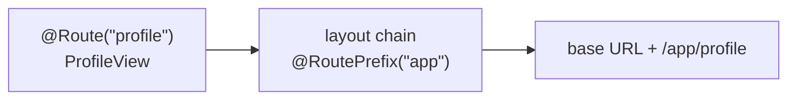

# 3. Navigation

Decided in [#16](https://github.com/parttio/unified-testing-tool/issues/16).

```java
page.navigate(ProfileView.class);                              // recommended
page.navigate(OrderView.class, 42L);                           // HasUrlParameter
page.navigate(OrderView.class, new RouteParameters("id", "42"));
page.navigate(PlanView.class, QueryParameters.of("week", "2026-11-02"));
page.navigate(OrderView.class, new RouteParameters("id", "42"), QueryParameters.of("tab", "2"));
page.navigate("profile?tab=2");                                // path, relative to the base URL
page.reload();

assertThat(page).isAt(ProfileView.class);
assertThat(page).hasPath("profile").hasQueryParameter("tab", "2");
assertThat(page).hasPathMatching("products/\\d+");               // a path the test only partly knows
assertThat(page).hasTitle("Profile");
```

| Rule | Detail |
|---|---|
| Two forms | Route class (refactor-safe, recommended) or path. Path form covers routes registered at runtime. |
| Query parameters | Either form: `QueryParameters` after the route class, with or without `RouteParameters`, as Flow's `UI.navigate(..)` takes them, or a query string in the path. The User Step names them: `open Plan with “week=2026-11-02”`. |
| Relative only | Paths are relative to the base URL. Absolute or external URLs need `@RequiresBrowser`. |
| User Step | The route class form reads `open People` (the view's name in words, without "View"); the path form reads the path as given, `open “profile?tab=2”`. The root route reads `open “/”`, whether it is spelled `""` or `"/"`, and so does a link click that navigates to it. |
| Returns nothing | Auto-Waits until the view is shown and the server is idle. The view instance is available only via the Escape Hatch (Browserless). |
| Flow types | Route classes, `RouteParameters`, `QueryParameters` from `flow-server`. |
| Reload | `page.reload()` on every Testing Tool (Browserless simulates it, `@PreserveOnRefresh` respected). |
| Back / forward | Escape Hatch only. |
| `isAt(view)` | Browsers match the page's current location (read in the page, so a RouterLink or `history.pushState` navigation counts) against the view's route template and each of its `@RouteAlias`es, with the layouts' prefixes: a required `:x` matches one segment, an optional `:x?` zero or one, a wildcard `:x*` the remaining ones; a regex constraint is not checked, nor are query parameters. A view with no route (an error view) is matched by the view the page's UI shows: `@UnifiedSpringBootTest` serves a test-only endpoint (`/__unified/current-view`) that answers for the caller's own Vaadin session. Browserless checks the current view's class. |
| `hasPath(path)`, `hasPathMatching(regex)` *(unreleased)* | The page's path, without a leading `/` and the query string, on every Testing Tool. `hasPath` compares it exactly. `hasPathMatching` checks it against a regular expression (a `String`, or a `java.util.regex.Pattern` for flags), which must match the whole path: `products/\d+` passes on `products/42`, not on `products` or `products/42/edit`; `products/.+` checks a prefix. A leading `/` in the pattern is ignored, as in `hasPath`. An invalid pattern throws `PatternSyntaxException` at the call, without waiting. The User Steps read `see path “profile”` and `see path matching “products/\d+”`. There is no path getter: the path is checked, not read ([ADR 0019](../adr/0017-the-page-path-is-checked-not-read.md)). |
| `hasTitle(title)` | The page's title, exactly, on every Testing Tool: what a view's `@PageTitle`, `HasDynamicTitle` or `Page.setTitle(..)` set. Browsers read `document.title`; Browserless reads the title the UI last sent (`UI.getInternals().getTitle()`), which Flow keeps on the server. A title set by the page's own script or the HTML template, not through Flow, is seen in a browser only. |

## Route class to URL (browser Testing Tools)

Resolved **statically** from annotations, without the running app's router:



Route parameters are filled into the template; without them, optional (`:x?`) and wildcard (`:x*`) segments are
dropped: `navigate(StorefrontView.class)` on `storefront/:orderID?` opens `storefront`. A route with a required
parameter (`:x`) can't be opened without it: `navigate(view)` fails with a `UnifiedAssertionError` naming the
parameter, on every Testing Tool.

Routes registered at runtime (`RouteConfiguration`) use the path form.

## Requirements on Testing Tool adapters

- Resolve route classes from `@Route` and parent layouts' `@RoutePrefix`, plus route and URL parameters, and query
  parameters (`AdapterSession.navigate(view, parameters, query)`; its default opens the path the annotations give)
.
- After navigation, wait for the target view and an idle server.
- Read the page's title as it is now (`AdapterSession.title()`).
- Location and title assertions retry until the timeout.
