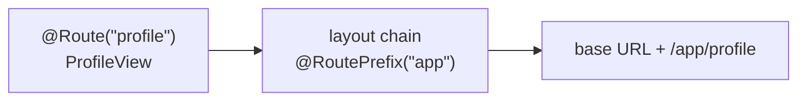

# 3. Navigation

Decided in [#16](https://github.com/parttio/unified-testing-tool/issues/16).

```java
page.navigate(ProfileView.class);                              // recommended
page.navigate(OrderView.class, 42L);                           // HasUrlParameter
page.navigate(OrderView.class, new RouteParameters("id", "42"));
page.navigate("profile?tab=2");                                // path, relative to the base URL
page.reload();

assertThat(page).isAt(ProfileView.class);
assertThat(page).hasPath("profile").hasQueryParameter("tab", "2");
assertThat(page).hasTitle("Profile");                          // unreleased
```

| Rule | Detail |
|---|---|
| Two forms | Route class (refactor-safe, recommended) or path. Path form covers query strings and routes registered at runtime. |
| Relative only | Paths are relative to the base URL. Absolute or external URLs need `@RequiresBrowser`. |
| Returns nothing | Auto-Waits until the view is shown and the server is idle. The view instance is available only via the Escape Hatch (Browserless). |
| Flow types | Route classes, `RouteParameters`, `QueryParameters` from `flow-server`. |
| Reload | `page.reload()` on every Testing Tool (Browserless simulates it, `@PreserveOnRefresh` respected). |
| Back / forward | Escape Hatch only. |
| `isAt(view)` | Browsers compare the page's current location (read in the page, so a RouterLink or `history.pushState` navigation counts) with the view's route. A view with no route (an error view) is matched by the view the page's UI shows: `@UnifiedSpringBootTest` serves a test-only endpoint (`/__unified/current-view`) that answers for the caller's own Vaadin session. Browserless checks the current view's class. |
| `hasTitle(title)` *(unreleased)* | The page's title, exactly, on every Testing Tool: what a view's `@PageTitle`, `HasDynamicTitle` or `Page.setTitle(..)` set. Browsers read `document.title`; Browserless reads the title the UI last sent (`UI.getInternals().getTitle()`), which Flow keeps on the server. A title set by the page's own script or the HTML template, not through Flow, is seen in a browser only. |

## Route class to URL (browser Testing Tools)

Resolved **statically** from annotations, without the running app's router:



Routes registered at runtime (`RouteConfiguration`) use the path form.

## Requirements on Testing Tool adapters

- Resolve route classes from `@Route` and parent layouts' `@RoutePrefix`, plus route and URL parameters.
- After navigation, wait for the target view and an idle server.
- Read the page's title as it is now (`AdapterSession.title()`) *(unreleased)*.
- Location and title assertions retry until the timeout.
