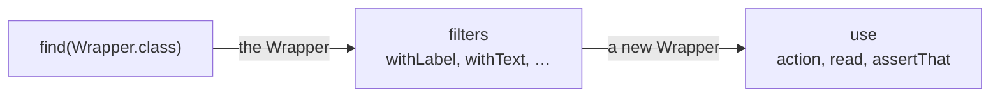

# 4. Locating components

Decided in [#7](https://github.com/parttio/unified-testing-tool/issues/7), [#12](https://github.com/parttio/unified-testing-tool/issues/12) and "What shape does a lookup take?" (#199); see [ADR 0001](../adr/0001-locator-filters-follow-component-type.md), [ADR 0002](../adr/0002-unified-wrapper-names-and-class-literal-lookups.md) and [ADR 0007](../adr/0007-wrappers-carry-their-filters.md). Templates: [#347](https://github.com/parttio/unified-testing-tool/issues/347), [ADR 0012](../adr/0012-lookups-enter-templates-explicitly.md). The style the lookups are written in: [12. Readable tests](12-readable-tests.md#lookups).

## Lookup shape

```java
page.find(UnifiedTextField.class).withLabel("Name").setValue("Alan M. Turing");
```



- `find(UnifiedX.class)` returns **the Wrapper itself**. There is no query type and no terminal: the Wrapper is the query.
- The Wrapper type acts as the role (like Playwright's `getByRole`). No role filter.
- Filters are methods of the Wrapper, declared as mixins (`UnifiedTextField extends CommonFilters<UnifiedTextField>, LabelFilter<UnifiedTextField>`, [6. Wrappers](06-wrappers.md#shape)), so each type offers **only the filters that make sense for it**. Wrong filters do not compile:

```java
page.find(UnifiedButton.class).withLabel("Save");   // compile error: Button has no label
page.find(UnifiedButton.class).withText("Save");    // OK
```

| Rule | Detail |
|---|---|
| Immutable | A filter returns a new Wrapper and never changes the one it was called on. A Wrapper can be declared once and narrowed in several ways. |
| Lazy | `find(..)` and the filters search nothing. A Wrapper never holds a component instance. |
| Exactly one, on every use | Every action, read and assertion finds the component again and waits up to the timeout for exactly one match ([5. Waiting](05-waiting.md)). No match or several fail with a `UnifiedAssertionError` naming the count and the Near Misses ([12. Readable tests, Failures](12-readable-tests.md#failures)). |

## Filters

Exact match by default (whitespace normalised); every text filter has a `…Containing` variant, which matches a case-insensitive substring.

| Filter | Matches | Mixin | Recommended |
|---|---|---|---|
| `withLabel` | `label` property, or the label of the FormLayout item holding the field (`addFormItem(field, "Name")`: the `<vaadin-form-item>`'s `slot="label"` child) | `LabelFilter` | yes |
| `withAccessibleName` | what a screen reader announces (see below) | `CommonFilters` (every type) | yes |
| `withText` | text content: `getText()`, the DOM text, the same on every Testing Tool | `TextFilter` | yes |
| `withPlaceholder` | `placeholder` | `PlaceholderFilter` | yes |
| `withTestId` | `data-testid` (`Component.setTestId`) | `CommonFilters` | fallback |
| `withId` | `id` | `CommonFilters` | fallback |
| `withClassName`, `withTheme`, `withAttribute` | CSS class, theme, attribute | `CommonFilters` | no (implementation details) |
| `withClassNames` | every one of several CSS classes; `withClassName` takes one class and rejects a name with spaces on every Testing Tool, as Flow's `addClassName` does | `CommonFilters` | no (implementation details) |
| `visible()` | visible components only (`isVisible()`) | `CommonFilters` | where visibility matters |
| `withProperty`, `where(Predicate<UnifiedElement>)` | building blocks for custom filters | `CommonFilters` | for Wrapper authors |
| type-specific, e.g. `withHeaderTitle` | declared by the Wrapper as a default method | that type | yes |

**Accessible name** order on every Testing Tool (Dramafinder's own filters use the browser's computation). `UnifiedElement.getAccessibleName()` reads the same value ([6. Wrappers](06-wrappers.md#unified-element)):

1. `aria-label`
2. the `accessibleName` property (what `setAriaLabel` sets on a field; the field forwards it to its input)
3. text of the `aria-labelledby` target
4. `label`
5. text content (buttons)

Rare edge cases can differ from the browser.

## What a lookup sees

The same on every Testing Tool:

| Rule | Detail |
|---|---|
| Hidden components | **included**: a component hidden after it was shown stays in a browser's page, so Browserless includes it too. Add `.visible()` for "the action is gone". A component that was never visible is in no browser's page (Flow doesn't send it), but Browserless finds it: `.visible()` gives the same answer everywhere. |
| Dialogs, notifications | open ones only; a closed dialog (the app's or the dev tools') is not part of the page |
| Shadow DOM | not searched by a lookup: neither Vaadin's components and the dev tools nor the app's own Templates. A test enters a Template explicitly ([Templates](#templates)) *(planned, [#347](https://github.com/parttio/unified-testing-tool/issues/347))* |
| Grid cell components | found page-wide for the rows the grid rendered, as a browser has them |
| No tag | a lookup for a component without a tag (`findComponent(Component.class)`, a `Composite`) fails at once on every Testing Tool: a browser can't find it |

Browser adapters put the filters CSS can express (id, test id, class, theme, attribute) into the selector and check the others in the page, for every candidate in one call.

**Guidance:** locate by what the user sees (type + label, accessible name or text). Use test id or id only when a component has no user-visible name.

## Checks and several matches

A lookup has no terminal. What used to need one is an assertion or `all()`:

| Intent | Write | Behaviour |
|---|---|---|
| use the one match | `find(..).withLabel("Name").setValue(..)` | waits for exactly one match |
| check it is there | `assertThat(wrapper).exists()` | retries until at least one matches |
| check it is gone | `assertThat(wrapper).doesNotExist()` | retries until none matches |
| check how many | `assertThat(wrapper).hasCount(n)` | retries until `n` match |
| loop over the matches | `for (var w : wrapper.all())` | lazy Wrappers by position: the `i`-th Wrapper is the `i`-th match whenever it is used |

There is no boolean `exists()`, no `first()` and no index lookup: when several components match, add a filter or a [scope](#scoping); when the order is the point, `all().get(i)` says so. `all()` is only for loops; counts are checked with `hasCount(n)`, which waits.

## Scoping

Every Wrapper that is a `Scope` (page, `UnifiedDialog`, `UnifiedContainer`, the plain HTML Wrappers, a `findComponent(..)` result) can start a lookup:

```java
UnifiedDialog dialog = page.find(UnifiedDialog.class).withHeaderTitle("Delete account?");
dialog.find(UnifiedButton.class).withText("Delete").click();

UnifiedContainer address = page.find(UnifiedContainer.class).withTestId("address-form");   // layouts
address.find(UnifiedTextField.class).withLabel("City").setValue("Turku");
```

A lookup inside a scope finds the scope again first, on every use: a missing scope fails with Near Misses for the scope.

It searches what the scope holds, not the scope itself: `dialog.find(UnifiedDialog.class)` finds a dialog inside the dialog, never the dialog. A part whose component is its content (a grid cell, a column header, `UnifiedDetails.content()`, `UnifiedTabSheet.content()`) finds that component, as a browser finds it in the cell or panel that holds it.

Components created by renderers (e.g. Grid cells) and the content of closed overlays are reached through their **owning Wrapper** on every Testing Tool ([7. Grid](07-grid.md)).

## Templates

*(planned, [#347](https://github.com/parttio/unified-testing-tool/issues/347))* Decided in #347; see [ADR 0012](../adr/0012-lookups-enter-templates-explicitly.md).

A **Template** is a component whose own content a test reaches only by entering it: an app's `LitTemplate`, whose `@Id` components live in its shadow root, or a web component that renders its content in the browser. No lookup enters a Template by itself. A test enters one Template at a time, by finding it as a Scope:

```java
page.findTemplate(StorefrontView.class)                    // no Wrapper of its own
    .find(UnifiedSearchBar.class)                          // a Wrapper with TemplateScope (6. Wrappers)
    .find(UnifiedButton.class).withId("new").click();
```

| Rule | Detail |
|---|---|
| Entering | `findTemplate(X.class)` on any Scope, for a Template without a Wrapper of its own (the tag from `@Tag`), or `find(..)` of a Wrapper that extends `TemplateScope` ([6. Wrappers](06-wrappers.md#templates)). There is no setting that makes lookups enter shadow roots. |
| What it searches | the Template's shadow root and its light DOM (slotted children, children the server added), not the shadow roots of nested Templates: each is entered with its own lookup. A slotted component is found once, where it is in the light DOM. |
| What is findable inside a `LitTemplate` | what the server knows, the same on every Testing Tool: the `@Id` components and what is under them. A browser takes the elements with an `id` in the shadow root, and what is under them; plain template HTML without an `id` is not found. |
| Portable lookups inside | `withId(..)`, and filters on state the server set. Text, labels and attributes written in the template's HTML are empty on the server: on Browserless such a filter doesn't match ([Appendix B](appendix-gaps.md#browserless-test)). |
| Ids | compared within the Template entered: the same id in two Templates is not ambiguous. |
| Client-rendered web components | entered the same way in a browser. Browserless can't see inside them: a test that enters one declares `@RequiresBrowser` ([9. Capabilities](09-capabilities.md#browser-only-features-in-the-unified-api)). |
| The Template's own text | `getText()` and `withText(..)` on a Template read its light DOM only, as on any component. |

A failed lookup that would have found its component inside a Template says so, with the lookup that enters it ([12. Readable tests, Failures](12-readable-tests.md#failures)).

## Components without a Wrapper

```java
UnifiedGenericComponent rating = page.findComponent(Rating.class).withLabel("Score");   // tag from @Tag
```

`findComponent(X.class)` returns a lazy `UnifiedGenericComponent` with the shared filters (`CommonFilters`, `LabelFilter`, `TextFilter`). It is a Scope.

## Escape Hatch only

CSS, XPath, ARIA role queries, predicates over a tool's own objects ([8. Escape Hatch](08-escape-hatch.md)).

## Requirements on Testing Tool adapters

| Adapter | Maps the Wrapper type to |
|---|---|
| Browserless | the Flow component class |
| Playwright | a locator from the web component tag |
| Selenium | the web component tag |

- Implement every filter in the table with the same meaning; exact match by default.
- Resolve a lookup on every use, and fail when zero or several components match, after waiting up to the timeout.
- Let the core list Near Misses: re-run a lookup without its user-facing filters, and read `label`, text, `placeholder`, `data-testid` and the accessible name of each candidate ([12. Readable tests](12-readable-tests.md#requirements-on-testing-tool-adapters)).
- TestBench before 25.4: implement `withTestId` with the `data-testid` attribute.
- *(planned, [#347](https://github.com/parttio/unified-testing-tool/issues/347))* Search a Template's shadow root and light DOM when a lookup is scoped on it, and never a shadow root otherwise. Browserless: walk the Template's virtual children (its `@Id` components), which Browserless Test's own walk leaves out.
