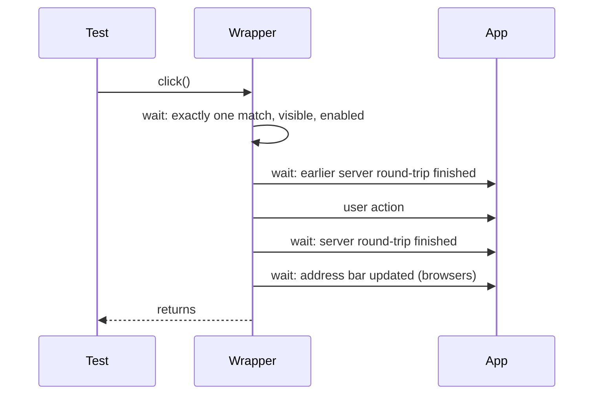

# 5. Waiting

Decided in [#8](https://github.com/parttio/unified-testing-tool/issues/8); lookups and checks as in [ADR 0007](../adr/0007-wrappers-carry-their-filters.md). Term: **Auto-Wait**.

## Auto-Wait

Every action (`click`, `setValue`, `navigate`, …) on every Testing Tool:



| Testing Tool | Before the action | After the action |
|---|---|---|
| Browserless | by construction | by construction (synchronous) |
| Playwright (Dramafinder) | Playwright actionability; **adapter adds** wait for Vaadin idle, at most 5 s | **adapter adds** wait for Vaadin idle |
| Selenium (TestBench) | **adapter adds** element-state wait; `waitForVaadin` | `waitForVaadin` |

**A round trip already under way**. An Escape Hatch action that reaches the server (a Playwright `Locator.click()`) returns before the server has answered, and that answer can start another round trip. If the next action acted meanwhile, the late answer would overwrite it ([#604](https://github.com/parttio/unified-testing-tool/issues/604)). So before acting, an action also waits until no Flow client is busy. Browserless is synchronous, and TestBench's commands wait for Vaadin. On Playwright the adapter does it in the same call to the page that checks the component is visible and enabled, so an idle page costs no extra round trip; a component with a visibility rule of its own takes one more call. Its wait is capped at 5 s: an app that is still busy then, such as one with a short `@Poll` interval or a long request, is acted on anyway rather than failing as not usable ([ADR 0014](../adr/0014-playwright-actions-wait-for-flow-idle-before-acting.md)). The server round trip after the action is still waited for in full.

**Address bar.** A server-side navigation (`ui.navigate(..)` in a listener) changes the address bar after Flow has handled the response: in a timeout, or in React mode through React Router while Flow's `Vaadin.Flow.navigation` flag is set. The round-trip wait is over by then. So after every action, the browser adapters also wait for that change (`AdapterSession.settle()`: one timeout, then while the flag is set, at most 2 s, then one more timeout, then the round trip the navigation may start). A one-shot read of the URL right after an action, through the Escape Hatch or a report, sees the new path ([#233](https://github.com/parttio/unified-testing-tool/issues/233)). The flag is Flow's internal, not an API.

**Page load.** When an action loads another page (a link out of the router, a login form's POST, `Page.setLocation`), the page fires `load` before Flow has started its UI: Flow starts it when the router asks for the server's routes, later still in development mode. Until then only Flow's `TypeScript` client is registered, and the page reads as idle while it shows nothing. So after an action that loaded a page, the Playwright adapter waits for `load`, then until Flow has registered a client of its own UI (at most 5 s: a page that runs Flow but shows no Flow UI, a Hilla view, never does), then for the round trip ([#397](https://github.com/parttio/unified-testing-tool/issues/397)). A page without Flow passes at once. A page load can start after Flow is idle again (`Page.setLocation` changes the location while Flow handles the response, and the browser asks for the next page after that), so the adapter also watches for the page starting one: the Navigation API's `navigate` event for another document, which fires before the request goes out, and Playwright's navigation requests.

Grid row and column actions (`row().withCellText(..).click()`, `column(..).sort(..)`) are Wrapper actions and get the same Auto-Wait ([7. Grid](07-grid.md)).

## Lazy Wrappers

`find(..)` returns a Wrapper that finds its component again on every action, read or assertion, and waits up to the timeout for exactly one match. It waits for components that appear later and never goes stale. A Wrapper never holds a component instance.

## Assertions and getters

| | Retries | Use |
|---|---|---|
| `assertThat(wrapper).hasValue("x")` | yes, until the timeout; failure shows expected and actual | checking state (recommended) |
| `wrapper.getValue()` | no (read after the round-trip) | reading a value to use it |

```java
assertThat(name).hasValue("Alice").isValid();          // good
assertEquals("Alice", name.getValue());                 // flaky in a browser after async updates
```

## Counts and absence

Whether a component is there, and how many are, are retrying assertions like any other. There is no boolean check:

| Assertion | Holds when |
|---|---|
| `assertThat(wrapper).exists()` | at least one component matches |
| `assertThat(wrapper).doesNotExist()` | no component matches |
| `assertThat(wrapper).hasCount(n)` | `n` components match |

```java
assertThat(page.find(UnifiedButton.class).withText("Approve").visible()).doesNotExist();
assertThat(users.row().withCellTextContaining("Email", "user11")).hasCount(11);
```

`all()` reads the matches now, without waiting: only for looping over them ([4. Locating](04-locating.md#checks-and-several-matches)).

## Failures

A lookup that finds no component or several, an action on a component that stays disabled or hidden, and an assertion that times out all throw `UnifiedAssertionError`, an `AssertionError`. Its message is the same on every Testing Tool: the User Step that failed, what was expected and found, the Near Misses, how long it waited and where the timeout came from ([12. Readable tests, Failures](12-readable-tests.md#failures)). An assertion timeout lists the distinct values it saw while waiting (`Found “Saving…”, then “Saved Alan Turing”`).

**What can't pass by waiting**. An attempt that throws counts as "not yet" and is tried again until the timeout, but for an `UnsupportedOperationException`: the Testing Tool can't do that, so the wait ends at the first attempt, without a `Waited` line. Either way, the failure names the error its last attempt threw in its `Cause` line ([ADR 0019](../adr/0019-only-what-a-testing-tool-cannot-do-ends-a-wait-early.md)).

## Background work

On Browserless, retrying assertions and waits run `roundTrip()` and `runPendingSignalsTasks()` between attempts, so views updated from background threads (`UI.access`, signals) behave the same as in a browser.

## Timeouts and generic waits

- One default timeout, `10s`, set with `vaadin.testing.timeout`.
- Per call: `wrapper.withTimeout(Duration.ofSeconds(30))`.
- Any other condition: `page.waitUntil(() -> …)`, same timeout and Browserless flushing.

## Turning Auto-Wait off

Not part of the Unified API. Use the Escape Hatch and the tool's own switch (e.g. TestBench `disableWaitForVaadin()`). Not possible on Browserless.

## Requirements on Testing Tool adapters

- Guarantee both halves of Auto-Wait for every action: before it, a round trip already under way (capped where the app may never be idle); after it, the action's round trip, including the address bar change of a server-side navigation (`settle()`).
- Re-resolve Wrappers on every call, and count the matches for `exists()`, `doesNotExist()` and `hasCount(n)`.
- Retry assertions until the timeout; on Browserless flush `UI.access` tasks and signals between attempts.
- Throw `UnsupportedOperationException` only for what the Testing Tool can never do, which ends the wait at once; throw another exception for what may change while the test waits, such as a row not rendered yet.
- Give grid row and column actions the same Auto-Wait as every other action.
