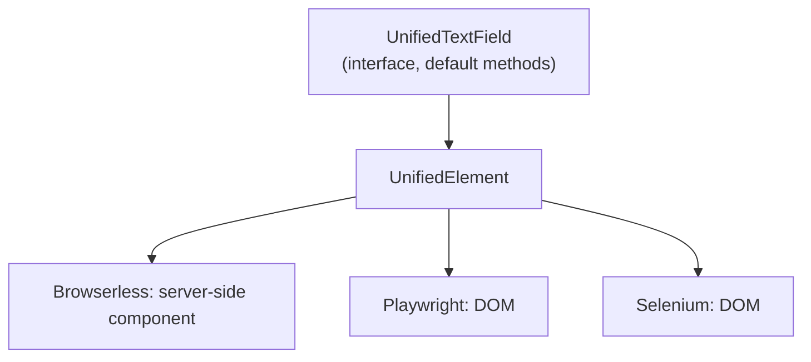

# 6. Wrappers

Decided in [#6](https://github.com/parttio/unified-testing-tool/issues/6) (Core Set), [#12](https://github.com/parttio/unified-testing-tool/issues/12) (wrapper shape) and [#18](https://github.com/parttio/unified-testing-tool/issues/18) (custom and add-on wrappers) and #199 (filters on the Wrapper); see [ADR 0002](../adr/0002-unified-wrapper-names-and-class-literal-lookups.md), [ADR 0003](../adr/0003-wrappers-are-interfaces-shipped-in-the-addon-jar.md) and [ADR 0007](../adr/0007-wrappers-carry-their-filters.md).

## Core Set

One component per interaction pattern. Every other component follows the same pattern.

| Pattern | Wrapper | Status |
|---|---|---|
| Text value | `UnifiedTextField`, `UnifiedTextArea`, `UnifiedEmailField`, `UnifiedPasswordField` | implemented; `UnifiedEmailField` and `UnifiedPasswordField` ([#555](https://github.com/parttio/unified-testing-tool/issues/555)) share the text-value contract `UnifiedTextInput` (`setValue`, `clear`, `getValue`, `getPlaceholder`, and `UnifiedField`'s getters) with the other two; what is typed into a password field, and its values in a failed check, read `••••`, and the Findable View shows no value for it |
| Typed value | `UnifiedNumberField`, `UnifiedIntegerField`, `UnifiedBigDecimalField`, `UnifiedDatePicker`, `UnifiedDateTimePicker` | implemented; `UnifiedDatePicker.typeText(..)` and `UnifiedDateTimePicker.typeText(date, time)` type unparsed text; `UnifiedDateTimePicker.typeText(LocalDate, time)` types the date in the field's own format, for incomplete input on every Testing Tool; `UnifiedDatePicker.setValue(..)` is ready when the field is visible and enabled or its calendar is open (`opened`), so it sets a picker whose field is hidden but whose calendar the application opened, through its `value`, and closes the calendar as a pick does ([#516](https://github.com/parttio/unified-testing-tool/issues/516)) |
| Boolean value | `UnifiedCheckbox` | implemented |
| Single selection | `UnifiedComboBox`, `UnifiedRadioButtonGroup` | implemented |
| Multi selection | `UnifiedMultiSelectComboBox` | implemented |
| Action | `UnifiedButton`, `UnifiedMenuBar` | implemented: `clickItem("File", "Export", "PDF")` opens the menus as a user does; items by Item Name (an icon-only item by its `aria-label`); `isItemEnabled(..)`; a top-level item folded into the overflow menu is still an item, but `clickItem` / `isItemEnabled` on it fail in a browser, pointing to `unfoldingOverflow()`, which reaches it through "More options" ([#664](https://github.com/parttio/unified-testing-tool/issues/664)); `getOverflowItems()`, `hasOverflowItems(..)`, `hasNoOverflowItems()` in a browser ([#493](https://github.com/parttio/unified-testing-tool/issues/493)) |
| Layout | `UnifiedAppLayout` | implemented ([#493](https://github.com/parttio/unified-testing-tool/issues/493)): `isDrawerOpened()`, `isOverlay()` (browser only: the browser decides it from the layout); `openDrawer()`, `closeDrawer()`, `toggleDrawer()` with the layout's DrawerToggle, or Escape on an opened overlay drawer, which covers the toggle; on Browserless the drawer is opened and closed as the browser tells the server, when the layout has a DrawerToggle |
| Links | `UnifiedLink` | implemented ([#561](https://github.com/parttio/unified-testing-tool/issues/561)): a `RouterLink`, an `Anchor` or any other `<a>`, bound to the tag; `withHref(..)`; `click()` follows the link and waits for the new page: a real click in a browser, the link's route on Browserless, where a link out of the application (another host, a servlet path, a download) or into another window (`target="_blank"`) fails asking for `@RequiresBrowser`; a click that navigated is followed by the `open` User Step; `getHref()` and `hasHref(..)` read the `href` as the application set it (relative for a `RouterLink`) on every Testing Tool |
| Side navigation | `UnifiedSideNav`, `UnifiedSideNavItem` | implemented ([#658](https://github.com/parttio/unified-testing-tool/issues/658)): an item by its label (`withLabel`, its own text, not its child items') or `withPath(..)`; both are Scopes, so a nested item is found in its parent item or its side nav; `click()` expands the collapsed items it is in by their toggle buttons, then follows the item's path as `UnifiedLink.click()` follows a link (a click on the item's own `<a>` in a browser, the path's route on Browserless, where a path out of the application or into another window fails asking for `@RequiresBrowser`), or toggles an item without a path, as the web component does; `expand()`, `collapse()`; `isCurrent()`, `isExpanded()`, `getPath()` (as the application set it), `getItems()`; on Browserless, an item is current when its path or an alias matches the page's location, hidden in a collapsed item, and the current item's parents expand after a navigation, as the web component does in a browser |
| Overlays | `UnifiedDialog`, `UnifiedConfirmDialog`, `UnifiedNotification` | implemented |
| Login | `UnifiedLogin` | implemented ([#564](https://github.com/parttio/unified-testing-tool/issues/564)): a `LoginOverlay` (found while open) or a `LoginForm`, bound to `AbstractLogin` with both tags; `withTitle(..)`; `login(username, password)` types and submits in a browser, which also follows a form `action`, and fires the `LoginEvent` on Browserless, where a component with an `action` fails asking for `@RequiresBrowser` or `@WithMockUser`; the password is a secret of the run, masked everywhere except inside its own user name, [#605](https://github.com/parttio/unified-testing-tool/issues/605); `forgotPassword()`; `isOpen()`, `isError()`, `getTitle()`, `getDescription()` |
| Disclosure | `UnifiedDetails` | implemented: `open()`, `close()`, `content()` Scope |
| Files | `UnifiedUpload` | implemented: `upload(name, type, bytes)` waits until the server has the file |
| Chat | `UnifiedMessageInput`, `UnifiedMessageList` | implemented: `send(text)` types and submits as a user does; a message's text is the one the application gave it (the Markdown source, not the rendered text), so every Testing Tool reads the same; `hasMessageCount(n)` and `hasMessageContaining(..)` wait for a reply ([#357](https://github.com/parttio/unified-testing-tool/issues/357)); one message is a lazy `message(i)` (0-based) or `message()` with `withUserName`, `withText`, `withTextContaining` and `last()`, checked with `exists`, `doesNotExist`, `hasCount`, `hasText`, `hasTextContaining` and `hasUserName` ([#515](https://github.com/parttio/unified-testing-tool/issues/515)) |
| Data | `UnifiedGrid` | in the sketch: [07-grid.md](07-grid.md) |
| Navigation | `UnifiedTabSheet`, `UnifiedTabs` | implemented: `selectTab(name)`, `getSelectedTab()`; a tab's name is its Item Name (the text of a tab holding a `RouterLink`); `selectTab` on a tab holding a link (a `RouterLink` or `Anchor`, its only `<a>`) follows the link as `UnifiedLink.click()` does ([#531](https://github.com/parttio/unified-testing-tool/issues/531)): a click on the `<a>` in a browser; on Browserless the tab is selected, then the link's route opened, and a link out of the application fails asking for `@RequiresBrowser`; a selection that navigated isn't read back, and is followed by the `open` User Step; a TabSheet's `content()` Scope follows the selected tab |
| (layouts, for scoping) | `UnifiedContainer` | implemented: any component, found by test id or id; `click()` for a layout with a click listener ([#358](https://github.com/parttio/unified-testing-tool/issues/358)) |
| (plain HTML, for scoping, text and clicks) | `UnifiedDiv`, `UnifiedSpan`, `UnifiedParagraph`, `UnifiedSection`, `UnifiedNav`, `UnifiedHeader`, `UnifiedFooter`, `UnifiedMain`, `UnifiedArticle`, `UnifiedAside` | implemented: bound to their tag, so one browser query; Scopes; `click()`, as each is a Flow `ClickNotifier` ([#358](https://github.com/parttio/unified-testing-tool/issues/358)) |

Input fields share `UnifiedField` (label, helper text, validation getters). Typed values are Java types: `Double` for a NumberField, `Integer`, `BigDecimal` (compare with `compareTo`: the scale is what the user typed), `LocalDate` for a DatePicker, `LocalDateTime` for a DateTimePicker, `null` when empty. Selection fields identify items by the label the user sees (the item label generator's result): `selectItem("Germany")`, `getSelectedItem()`, `getItems()`. A select fails when the item doesn't exist (listing the items) or isn't selected afterwards. A combo box's `getItems()` returns every item, paging through a lazy data provider; on Selenium only the items its drop-down loads at once (first page, 50 by default; [#127](https://github.com/parttio/unified-testing-tool/issues/127)).

Rules: a Core Set component is supported by all three Testing Tools; no commercial components (Grid Pro, Charts, Spreadsheet, Board, Crud); no layouts.

## Naming

Prefix `Unified`. The plain and suffixed names are taken by classes a test may import at the same time:

| Name | Taken by |
|---|---|
| `TextField` | Flow component |
| `TextFieldElement` | Dramafinder **and** TestBench |
| `TextFieldTester`, `TextFieldLocator` | Browserless |

## Shape



A wrapper is an **interface with default methods** over `element()`. The Unified API implements it at runtime. Authors write no implementation class. A Wrapper carries its own filters: it lists the filter mixins it accepts, with itself as the type parameter, and the Unified API implements them too.

```java
@UnifiedComponent(TextField.class)
public interface UnifiedTextField extends UnifiedField,
        CommonFilters<UnifiedTextField>, LabelFilter<UnifiedTextField>, PlaceholderFilter<UnifiedTextField> {

    default void setValue(String value) { element().setValueAsUser(value); }          // action, Auto-Wait
    default String getValue() { return element().getProperty("value"); }             // getter, immediate
}
```

| Part | Rule |
|---|---|
| Filters | Mixins in `com.vaadin.testing.unified.query`: `CommonFilters<W>` (every Wrapper: accessible name, test id, id, `visible()`, `where(..)`, `all()`, …), `LabelFilter<W>`, `TextFilter<W>`, `PlaceholderFilter<W>`. Each filter returns a new Wrapper of type `W` and leaves the one it was called on unchanged. Type-specific filters are default methods built from `where(..)` or `withProperty(..)` ([Custom filters](#custom-filters)). |
| Actions | Auto-Wait (`setValue`, `clear`, `click`, …) |
| Getters | Immediate, no retry |
| Assertions | Static `assertThat(wrapper)` in `UnifiedAssertions`, retrying |
| Every wrapper | `element()`, `unwrap`, `tryUnwrap`, `withTimeout`, `isVisible`, `isEnabled` |
| Scopes | `UnifiedDialog`, `UnifiedDetails`, `UnifiedContainer`, `UnifiedSideNav`, `UnifiedSideNavItem`, the plain HTML wrappers and any `findComponent(..)` result also have `find` |

## Unified Element

The portable layer every wrapper is written on:

| Group | Operations |
|---|---|
| Read | `getTag`, `getText`, `getAccessibleName`, `getProperty…`, `getAttribute`, `getInlineStyle`, `isVisible`, `isEnabled`, `getVisibleText` and `getCssValue` (browser only) |
| Write | `setProperty` |
| User actions (Auto-Wait) | `click`, `setValueAsUser`, `focus`, `blur`, `pressKey`, `dispatchEvent` |
| Structure | `findChildren(tag)`, `children()`, `findDescendants(tag)` |

| Operation | Meaning on every Testing Tool |
|---|---|
| `getText()` | the DOM text (`textContent`), whitespace collapsed and trimmed. CSS doesn't change it: `text-transform`, hidden descendants and line breaks between flex items don't count. A tooltip (`setTooltipText`) isn't part of it, though its text sits in the DOM in a browser. Browserless reads the same text from the server-side elements. |
| `getVisibleText()` | the text as rendered (`innerText`); browser only |
| `getAccessibleName()` | what a screen reader announces, in [4. Locating](04-locating.md#filters)'s order: what `withAccessibleName(..)` matches. Read for Near Misses and by tests |
| `getInlineStyle(name)` | the value the inline style declares, as written (`var(--gap)`), or null |
| `findChildren(tag)` | direct light-DOM children with this tag (`*`: any), in order; text nodes don't count; never a web component's shadow DOM. `children()` is `findChildren("*")`. |
| `findDescendants(tag)` | every light-DOM element below, in document order. Web components add light DOM of their own in a browser (a text field's input and label), which Browserless doesn't have. |
| `setValueAsUser` on a native `<input>` | sets the value and fires `input` and `change`, for Flow's `Input` and a bare `Element("input")` |
| `setValueAsUser` on a text input, number field or date picker | the value arrives as a user's does: the field's `setModelValue(.., fromClient)` runs with `fromClient` true, which an application's own field may override. Browserless sends it as the element's property update from the client (a number as the browser's text, a date as its ISO value), after the tester's checks; a field that doesn't synchronize its value only shows it, as in a browser |

Browserless acts on the server-side element and component, firing events as from the browser. Browser Testing Tools act on the DOM. **Limitation:** on Browserless a property is the server-side value; it equals the browser value only for properties Flow synchronises.

## Custom and add-on components

### Identifying the component

`@UnifiedComponent(Rating.class)`: the Flow class for Browserless; the tag for browsers is read from its `@Tag`. Add `tag = "…"` only for `Composite`-based components.

A component built from a common one (`MetricCard extends VerticalLayout`) has that one's tag: a browser can't tell it apart by class. `selector` adds what tells it apart, applied by every Testing Tool:

```java
@UnifiedComponent(value = MetricCard.class, selector = ".metric-card")
public interface UnifiedMetricCard extends UnifiedWrapper, CommonFilters<UnifiedMetricCard>,
        TextFilter<UnifiedMetricCard> { … }
```

`selector` is a compound CSS selector of `.class`, `#id`, `[attribute="value"]` and `[theme~="value"]`, without spaces. Wrapper interfaces must be public, and so must the classes they are nested in.

### Per-tool overrides

When the Unified Element is not enough (canvas, overlays, content written by client-side JavaScript, which Browserless doesn't run):

```java
@UnifiedComponent(value = Badge.class,
        overrides = @ToolImplementation(tool = TestingTool.BROWSERLESS, value = UnifiedBadgeBrowserless.class))
public interface UnifiedBadge extends UnifiedWrapper, CommonFilters<UnifiedBadge> {
    default int getCount() { return Integer.parseInt(element().getText().split(" ")[0]); }  // "3 new"
}

public interface UnifiedBadgeBrowserless extends UnifiedBadge {
    @Override
    default int getCount() { return unwrap(Badge.class).getCount(); }   // Escape Hatch: the Java component
}
```

| Rule | Detail |
|---|---|
| Shape | an **interface extending the wrapper**; it redefines only the methods that need the tool's own API, the rest is inherited |
| When used | on that Testing Tool, the wrapper returned by `find(..)` implements the override (`instanceof UnifiedBadgeBrowserless`) |
| Wrong shape | a class, or an interface not extending the wrapper: fails at the first `find(..)` with a message |

Implemented; demo: `demo.addon` (component) and `demo.addon.testing` (wrappers, in the main jar).

### Templates

A Wrapper for a [Template](04-locating.md#templates) extends the `TemplateScope` mixin. It is then a Scope whose lookups search the Template's shadow root and light DOM:

```java
@UnifiedComponent(SearchBar.class)                  // SearchBar extends LitTemplate, @Tag("search-bar")
public interface UnifiedSearchBar extends UnifiedWrapper, CommonFilters<UnifiedSearchBar>, TemplateScope {
}

page.find(UnifiedSearchBar.class).find(UnifiedButton.class).withId("new").click();
```

Without a Wrapper, `findTemplate(SearchBar.class)` on any Scope does the same.

### Custom filters

Default methods on the Wrapper, returning the Wrapper, built from `withProperty`, `withAttribute` or `where(Predicate<UnifiedElement>)`:

```java
@UnifiedComponent(Rating.class)
public interface UnifiedRating extends UnifiedWrapper, CommonFilters<UnifiedRating>, LabelFilter<UnifiedRating> {
    default UnifiedRating withValue(int stars) {
        return where(e -> Integer.valueOf(stars).equals(e.getPropertyInteger("value")));
    }
}
```

A custom filter reads as itself in User Steps and failures (`dialog with header title “Edit person”`, `Did you mean find(UnifiedDialog.class).withHeaderTitle("Edit person")`), not as `where(..)`. A `where(..)` the test calls directly is opaque: it shows as a gap line in the reports ([12. Readable tests](12-readable-tests.md#user-steps)).

### In the reports

Every action of an add-on Wrapper is a User Step ([12. Readable tests](12-readable-tests.md#user-steps)). Its wording comes from the Wrapper:

| Part | Default | Override |
|---|---|---|
| Component kind | the Wrapper's name in words, without `Unified` (`UnifiedRating` → “rating”) | `@UnifiedComponent(value = Rating.class, kind = "star rating")` |
| Verb | the core verb table (`click`, `setValue` → “fill”, …), else the method name in words (`setRating(4)` → `set rating rating “Food” with “4”`) | `@UserStepVerb("rate")` on the method: `rate star rating “Food” with “4”`; `{value}` places the arguments: `@UserStepVerb("give {value} stars to")` reads `give “4” stars to star rating “Food”` |

### Three ways to test an add-on

| Effort | How | When |
|---|---|---|
| none | `page.findComponent(Rating.class)`: shared filters + Unified Element | any add-on, today |
| low (recommended) | wrapper interface **in the add-on's own jar**, Unified API as `optional` dependency | add-on authors; works with single-module Vaadin Directory add-ons |
| shared | community bundle (e.g. `unified-addons`) | popular add-ons without their own wrapper |

The Core Set is built with this same mechanism, with overrides where needed.

## Requirements on Testing Tool adapters

- Implement every Unified Element operation with the same meaning.
- Implement Wrapper interfaces and their filter mixins at runtime (`InvocationHandler.invokeDefault`) and honour `@ToolImplementation` overrides.
- Expose the accessible name through the Unified Element (`getAccessibleName()`).
- Read the tag from `@Tag` unless `@UnifiedComponent.tag` is set.
