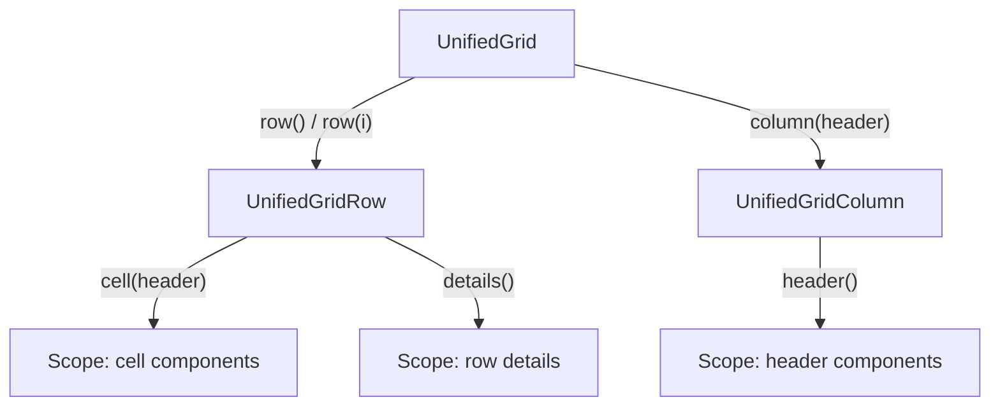

# 7. Grid

Decided in [#28](https://github.com/parttio/unified-testing-tool/issues/28) and, for the row lookup, [ADR 0007](../adr/0007-wrappers-carry-their-filters.md), from the prototype on branch [`prototype/grid-wrapper`](https://github.com/parttio/unified-testing-tool/tree/prototype/grid-wrapper/prototypes/grid-wrapper). Sketch: [`UnifiedGrid`](../../spec/api-sketch/src/main/java/com/vaadin/testing/unified/component/UnifiedGrid.java), example [`UsersViewTest`](../../spec/api-sketch/src/test/java/example/UsersViewTest.java).

## Shape

Rows are found by **what they show**, the way components are: `row()` returns a lazy row, its filters narrow it, and every use finds it again. Index access stays for tests where order is the point.

```java
UnifiedGrid users = page.find(UnifiedGrid.class).withTestId("users");

users.column("Name").header().find(UnifiedTextField.class).setValue("Ali");   // header filter
assertThat(users).hasRowCount(1);

UnifiedGrid.UnifiedGridRow alice = users.row().withCellText("Name", "Alice");
assertThat(alice).hasCellText("Email", "alice@example.com");
alice.cell("Actions").find(UnifiedButton.class).withText("Edit").click();   // component in a cell

alice.select();
alice.toggleDetails();
alice.details().find(UnifiedButton.class).withText("Reset password").click();
assertThat(users.row().selected()).hasCount(1);
assertThat(users.row().withCellText("Name", "Mallory")).doesNotExist();

users.column("Name").sort(SortDirection.ASCENDING);
assertThat(users.column("Name")).isSortedAscending().hasCellTexts("Alice", "Bob", "Carol");
assertThat(users.row(0)).hasCellText("Name", "Alice");
```



## API

| Object | Members |
|---|---|
| `UnifiedGrid` | `row()`, `row(i)`, `getRowCount()`, `column(header)`, `columnWithId(id)`, `column(index)`, `getColumnHeaders()`, `selectAll()`, `deselectAll()` |
| `UnifiedGridRow` filters | `withCellText(column, text)`, `withCellText(text)` (any column; reads every column, so slower on large lazy Grids), `withCellTextContaining(..)`, `selected()`; each returns a new row and leaves this one unchanged. `all()`: every matching row now, by index, only for loops |
| `UnifiedGridRow` | `grid()`, `getIndex()`, `getCellText(column)`, `getCellText(index)` (columns without header text), `cell(column)` (Scope), `cell(index)` (Scope, columns without header text) *(unreleased)*, `select()`, `deselect()`, `isSelected()`, `click()`, `doubleClick()`, `toggleDetails()`, `isDetailsOpen()`, `details()` (Scope) |
| `UnifiedGridColumn` | `header()` (Scope), `sort(direction)`, `getSortDirection()`, `getCellTexts()` |

| Retrying assertion | On |
|---|---|
| `hasRowCount(n)`, `isEmpty()`, `hasColumn(header)`, `doesNotHaveColumn(header)`, `hasColumnHeaders(…)` | grid |
| `exists()`, `doesNotExist()`, `hasCount(n)`, `isSelected()`, `isNotSelected()`, `hasCellText(column, text)`, `hasDetailsOpen()`, `hasDetailsClosed()` | row |
| `hasCellTexts(…)`, `isSortedAscending()`, `isSortedDescending()` | column |

## Rules

| Rule | Detail |
|---|---|
| Exactly one row | A row from `row()` stands for every row its filters match. Each action, read and assertion on it waits up to the timeout for exactly one match, and fails with the count otherwise ([12. Readable tests, Failures](12-readable-tests.md#failures)). `row(i)` is the row at that index. |
| Auto-Wait | Row and column actions (`click`, `doubleClick`, `select`, `toggleDetails`, `sort`) are Wrapper actions: they wait for the grid and the row like any other action, and record a User Step (`click row where Name is “Alan Turing” in grid`). |
| Columns | By header text (recommended); `columnWithId(id)` for columns without header text (`Column.setId`, sent to the browser as the column element's id); `column(index)` among visible columns in display order as a last resort. **No lookup by key:** `Column.setKey` stays on the server, so no browser Testing Tool can see it. |
| Values | Rendered text only. The item behind a row: Escape Hatch (Browserless). |
| Lazy loading | Row access scrolls the row into view and waits for its data (Auto-Wait). `getRowCount()` is the total, not the rendered rows. |
| Cell components | Through `row.cell(column)` on every Testing Tool (Browserless queries can't see renderer components). |
| Renderer markup *(unreleased)* | Markup a `LitRenderer` draws (no Flow component) is found in `row.cell(..)` by a Wrapper bound to its tag, in a browser. On Browserless, a lookup in such a cell fails, naming `@RequiresBrowser`; it never finds nothing. Running a renderer function is no Unified call: Escape Hatch, `GridTester.invokeLitRendererFunction` ([ADR 0015](../adr/0015-renderer-markup-is-found-by-tag-wrappers-row-click-avoids-it.md)). |
| Row click | `click()` and `doubleClick()` click a spot of the row free of interactive content (links, buttons, focusable content, web components, renderer markup), on Playwright and Selenium alike *(unreleased: Selenium clicked the first cell's content)*. A row with no such spot fails with the same message on both, naming `row.cell(..).find(..).click()`. Browserless fires the grid's item click. |
| Selection | Single and multi; `selectAll` / `deselectAll`. The multi-select checkbox column is not a column: indexes count only the application's columns (as Flow's `Grid.getColumns()`). |
| Row details | `toggleDetails()` is what a user does: click the row (details open on click, Flow's default). Searching inside details (`details()`) is not available on Browserless yet (gap ticket). |

## Not in this version

TreeGrid, column reordering, Grid context menu, Grid Pro editing, drag and drop: listed in [open-questions.md](open-questions.md); they follow the same pattern later.

## Requirements on Testing Tool adapters

| Adapter | Implements Grid with |
|---|---|
| Browserless | `GridTester` (`getCellText`, `getCellComponent`, `select`, `sortByColumn`, …) |
| Playwright | Dramafinder `GridElement` (`findRowIndexesWithColumnText`, `getCell`, `waitForGridToStopLoading`, …) |
| Selenium | TestBench `GridElement` (`getCell`, `scrollToRow`, `select`, …) |

- Scroll and wait for data before any row access.
- Give grid row and column actions the same Auto-Wait as every other action, and count matching rows for `hasCount(n)` and `doesNotExist()`.
- Resolve column header text the same way on every tool.
