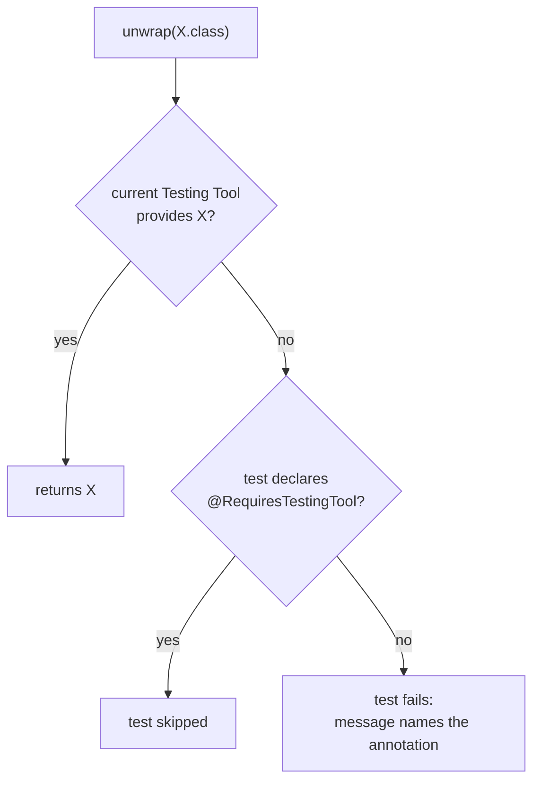

# 8. Escape Hatch

Decided in [#10](https://github.com/parttio/unified-testing-tool/issues/10).

```java
Locator locator = name.unwrap(Locator.class);                 // fails on other Testing Tools
name.tryUnwrap(Locator.class)                                 // empty on other Testing Tools
    .ifPresent(l -> l.evaluate("e => getComputedStyle(e).color"));
WebDriver driver = page.unwrap(WebDriver.class);
```

## Types

| Testing Tool | Wrapper / Unified Element | UnifiedPage |
|---|---|---|
| Playwright | Dramafinder element (e.g. `TextFieldElement`), `Locator` | `Page` |
| Selenium | TestBench element (e.g. `TextFieldElement`), `WebElement` | `WebDriver` |
| Browserless | tester (e.g. `TextFieldTester`), `Component` | `BrowserlessUIContext` |

No compile-time dependency on any Testing Tool: only the tool a run uses must be on the classpath.

## Rules



| Case | Use |
|---|---|
| Test needs one tool | `@RequiresTestingTool(PLAYWRIGHT)` + `unwrap` |
| TestBench test base API (`$(..)`, `executeScript`, `waitUntil`) on Selenium, as in a migrated test | `TestBenchEscapeHatch.of(page)` + `@RequiresTestingTool(SELENIUM)` ([ADR 0004](../adr/0004-test-migration-openrewrite-recipes-then-agent-skill.md)) |
| Browserless Test's test base API (`test(..)`, `$(..)`, `$view(..)`, `fireShortcut`) on Browserless, as in a migrated test | `BrowserlessEscapeHatch.of(page)` + `@RequiresTestingTool(BROWSERLESS)` ([ADR 0005](../adr/0005-browserless-migration-recipes.md)) |
| Extra check, test runs everywhere | `tryUnwrap`, no annotation |
| Server-side state (fields, beans) | `unwrap(Component.class)` + `@RequiresTestingTool(BROWSERLESS)` |
| Disable Auto-Wait, back/forward, network, tracing | the tool's own API |

Inside an Escape Hatch there are **no** Unified API guarantees: no Auto-Wait, no lazy lookup, no retrying assertions, no User Steps and no Near Misses.

## In the reports

The User Step recorder can't see what runs inside an Escape Hatch. Entering one (`unwrap`, `tryUnwrap`, an `…EscapeHatch` method) shows as one gap line among the User Steps, never left out silently ([12. Readable tests, User Steps](12-readable-tests.md#user-steps)):

```
   3  click button “Save”
   … 2 calls outside the Unified API (Escape Hatch)
   4  see notification “Saved Alice”
```

In `user-steps.json` the line is an entry of type `gap`, with `reason` `Escape Hatch` and `count`: how often the Escape Hatch was entered, not what ran inside.

## Style rule

The opt-in style rule `TOOL_CODE_NEEDS_CAPABILITY` ([12. Readable tests, Style rules](12-readable-tests.md#style-rules)) fails a Unified UI Test class that calls an Escape Hatch, or depends on Playwright, TestBench or Browserless packages, directly or through its own helpers, without `@RequiresTestingTool` on the class or test method. `tryUnwrap(..)` is an optional extra check and needs no annotation; nor do the class's own helpers it calls, unless they call `unwrap(..)` or an Escape Hatch. Guide: [Checking the style](../guide/style-rules.md).

## Requirements on Testing Tool adapters

- Provide the types in the table, both the tool's own wrapper and the raw object.
- Without `@RequiresTestingTool`, a failed `unwrap` names the annotation to add.
- Report every entry into an Escape Hatch to the User Step recorder, so the reports show the gap line.
