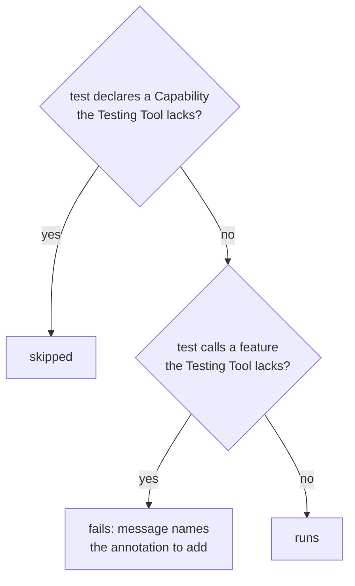

# 9. Capabilities and limitations

Decided in [#11](https://github.com/parttio/unified-testing-tool/issues/11) and [#9](https://github.com/parttio/unified-testing-tool/issues/9).

## Capabilities

| Annotation | Means | Missing on |
|---|---|---|
| `@RequiresBrowser` | real browser: CSS, layout, client JS, real focus and keyboard, screenshots | Browserless |
| `@RequiresTestingTool(X)` | uses a tool-specific Escape Hatch | every tool except X |



Handled at **runtime**, not compile time, so tests stay written once. The opt-in style rule `TOOL_CODE_NEEDS_CAPABILITY` checks at build time that a test reaching a Testing Tool's own code declares `@RequiresTestingTool` ([8. Escape Hatch, Style rule](08-escape-hatch.md#style-rule), [12. Readable tests, Style rules](12-readable-tests.md#style-rules)).

## Browser-only features in the Unified API

Each needs `@RequiresBrowser`:

```java
@Test
@DisplayName("The save button looks clickable")
@RequiresBrowser
void looksRight(UnifiedPage page) {
    page.navigate(ProfileView.class);
    assertThat(page.find(UnifiedButton.class).withText("Save")).hasCssValue("cursor", "pointer");
    page.screenshot(Path.of("target/profile.png"));
}
```

Network interception, tracing and browser contexts: Escape Hatch only.

### Browser-only steps in a test for every Testing Tool

A test that runs on every Testing Tool but has a browser-only step asks `page.hasRealBrowser()` instead of declaring `@RequiresBrowser`. False on Browserless, true on Playwright and Selenium:

```java
@Test
@DisplayName("The user edits their profile")
void editProfile(UnifiedPage page) {
    page.navigate(ProfileView.class);
    // ... steps and assertions, on every Testing Tool ...
    if (page.hasRealBrowser()) {
        page.screenshot(Path.of("target/profile.png"));
    }
}
```

## Keyboard

`pressKey` works on every Testing Tool, with Playwright's key names (`"Enter"`, `"Escape"`, `"Control+s"`). On Browserless keyboard and focus are simulated:

| | Browserless |
|---|---|
| `element.pressKey(k)` | the component's own handling (Escape closes a dialog), else a `keydown` on the component and each ancestor up to the UI, as bubbling would: key listeners and shortcuts (`addClickShortcut(..).listenOn(..)`) react |
| `page.pressKey(k)` | the same, from the focused component; with a dialog open, from the dialog |
| `dispatchEvent(name)` | the DOM event on the component and each ancestor |
| `page.reload()` | new view and layout instances at the same location; kept with `@PreserveOnRefresh` |
| Not simulated | client-side behaviour: typing text, Tab moving focus, browser defaults |

Tests that depend on real browser focus behaviour declare `@RequiresBrowser`.

## Limitations

| | Playwright (Dramafinder) | Selenium (TestBench) | Browserless |
|---|---|---|---|
| CSS, layout, client JS, screenshots | ✓ | ✓ | ✗ (text snapshot of the component tree) |
| Real keyboard and focus | ✓ | ✓ | simulated |
| "Visible" means | rendered | rendered | server-side `setVisible`; CSS-hidden counts as visible |
| Text as rendered (`getVisibleText`) | ✓ | ✓ | ✗ (`getText()`, the DOM text, works everywhere) |
| Property values | browser | browser | server-side; equal only for synchronised properties |
| Server-side Java state | ✗ | ✗ | ✓ (Escape Hatch) |
| Network interception, tracing | ✓ (Escape Hatch) | ✗ | ✗ |
| The console's errors *(unreleased)* ([chapter 12](12-readable-tests.md#log-lines-under-the-user-step)) | ✓ | Chrome only | ✗ (no console) |
| External URLs | ✓ | ✓ | ✗ |
| Back / forward history | Escape Hatch | Escape Hatch | ✗ |

Differences in meaning are documented, not banned. Tests that depend on the browser meaning declare `@RequiresBrowser`.

## Failure evidence

| Testing Tool | Captured automatically on failure |
|---|---|
| Playwright, Selenium | full-page screenshot: `<test class>.<method>.png` |
| Browserless | location and component tree as text: `<test class>.<method>.tree.txt`, the component the failed step acted on marked `← this step` |
| every Testing Tool | the [Findable View](12-readable-tests.md#findable-view) of the page: `<test class>.<method>.view.txt` |

Written to `vaadin.testing.evidence-dir` (default `target/surefire-reports/unified-evidence`, so CI uploads it with the reports), before the session closes. The failure names the files (a suppressed exception), so they show in the test report. Next to them, every test writes its User Steps (`<test class>/<test method>/user-steps.txt` and `user-steps.json`), and the run writes `summary.md`; the failure's `Evidence` line names that directory ([12. Readable tests, Reports](12-readable-tests.md#reports)).

## Requirements on Testing Tool adapters

- Report missing Capabilities as skipped tests.
- Unsupported calls without the annotation fail with a message naming it.
- Capture failure evidence as in the table, for the failed User Step.
