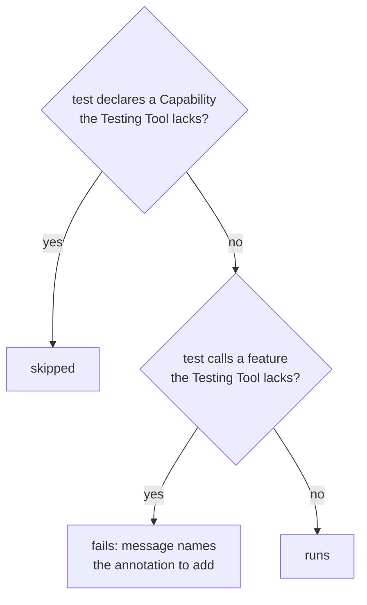

# 9. Capabilities and limitations

Decided in [#11](https://github.com/parttio/unified-testing-tool/issues/11) and [#9](https://github.com/parttio/unified-testing-tool/issues/9).

## Capabilities

| Annotation | Means | Missing on |
|---|---|---|
| `@RequiresBrowser` | real browser: CSS, layout, client JS, real focus and keyboard, screenshots | Browserless |
| `@RequiresTestingTool(X)` | uses a tool-specific Escape Hatch | every tool except X |
| `@Viewport(width, height, name)` | runs at this exact Viewport ([ADR 0011](../adr/0011-responsive-testing-viewports-layout-findings-viewport-comparison.md)); implies `@RequiresBrowser` | Browserless; also skipped, with the Testing Tool's reason, when its page opens and the Testing Tool can't set an exact Viewport |



Handled at **runtime**, not compile time, so tests stay written once. The opt-in style rule `TOOL_CODE_NEEDS_CAPABILITY` checks at build time that a test reaching a Testing Tool's own code declares `@RequiresTestingTool` ([8. Escape Hatch, Style rule](08-escape-hatch.md#style-rule), [12. Readable tests, Style rules](12-readable-tests.md#style-rules)).

## Browser-only features in the Unified API

Each needs `@RequiresBrowser`:

```java
@Test
@DisplayName("The save button looks clickable")
@RequiresBrowser
void looksRight(UnifiedPage page) {
    page.navigate(ProfileView.class);
    assertThat(page.find(UnifiedButton.class).withText("Save")).hasCssValue("cursor", "pointer");
    page.screenshot(Path.of("target/profile.png"));
}
```

Network interception, tracing and browser contexts: Escape Hatch only.

`page.setViewport(width, height)` resizes the Viewport mid-test, as a User Step that waits until the server has heard of it; `page.viewport()` reads it. The size a test starts at is `@Viewport` or the run's `vaadin.testing.viewport` ([ADR 0011](../adr/0011-responsive-testing-viewports-layout-findings-viewport-comparison.md)).

Entering a [Template](04-locating.md#templates) that renders its content in the browser (a web component, not a `LitTemplate`'s `@Id` components) needs `@RequiresBrowser`: Browserless has no such content.

### Browser-only steps in a test for every Testing Tool

A test that runs on every Testing Tool but has a browser-only step asks `page.hasRealBrowser()` instead of declaring `@RequiresBrowser`. False on Browserless, true on Playwright and Selenium:

```java
@Test
@DisplayName("The user edits their profile")
void editProfile(UnifiedPage page) {
    page.navigate(ProfileView.class);
    // ... steps and assertions, on every Testing Tool ...
    if (page.hasRealBrowser()) {
        page.screenshot(Path.of("target/profile.png"));
    }
}
```

## Keyboard

`pressKey` works on every Testing Tool, with Playwright's key names (`"Enter"`, `"Escape"`, `"Control+s"`). On Browserless keyboard and focus are simulated:

| | Browserless |
|---|---|
| `element.pressKey(k)` | the component's own handling (Escape closes a dialog), else a `keydown` on the component and each ancestor up to the UI, as bubbling would: key listeners and shortcuts (`addClickShortcut(..).listenOn(..)`) react |
| `page.pressKey(k)` | the same, from the focused component; with a dialog open, from the dialog |
| `dispatchEvent(name)` | the DOM event on the component and each ancestor |
| `page.reload()` | new view and layout instances at the same location; kept with `@PreserveOnRefresh` |
| Not simulated | client-side behaviour: typing text, Tab moving focus, browser defaults |

Tests that depend on real browser focus behaviour declare `@RequiresBrowser`.

## Limitations

| | Playwright (Dramafinder) | Selenium (TestBench) | Browserless |
|---|---|---|---|
| CSS, layout, client JS, screenshots | ✓ | ✓ | ✗ (text snapshot of the component tree) |
| Real keyboard and focus | ✓ | ✓ | simulated |
| "Visible" means | rendered | rendered | server-side `setVisible`; CSS-hidden counts as visible |
| Text as rendered (`getVisibleText`) | ✓ | ✓ | ✗ (`getText()`, the DOM text, works everywhere) |
| Property values | browser | browser | server-side; equal only for synchronised properties |
| Server-side Java state | ✗ | ✗ | ✓ (Escape Hatch) |
| Network interception, tracing | ✓ (Escape Hatch) | ✗ | ✗ |
| The console's errors ([chapter 12](12-readable-tests.md#log-lines-under-the-user-step)) | ✓ | Chrome only | ✗ (no console) |
| External URLs | ✓ | ✓ | ✗ |
| Before the first `navigate(..)` | a blank page | a blank page | the view of the `""` route |
| `navigate(..)` to the view already shown | a new page, new view instances | a new page, new view instances | the same view instance; `beforeEnter` and `setParameter` run again |
| Back / forward history | Escape Hatch | Escape Hatch | ✗ |
| Inside a Template: text, labels and attributes written in the template's HTML | ✓ | ✓ | ✗ (empty on the server; `withId(..)` works everywhere) |

Differences in meaning are documented, not banned. Tests that depend on the browser meaning declare `@RequiresBrowser`.

## Failure evidence

| Testing Tool | Captured automatically on failure |
|---|---|
| Playwright, Selenium | screenshot: `failure.png` (Playwright: the full page; Selenium: the window), with the failed step's Step Target's box in `user-steps.json` |
| Browserless | location and component tree as text: `failure.tree.txt`, the failed step's Step Target marked `← this step` |
| every Testing Tool | the [Findable View](12-readable-tests.md#findable-view) of the page: `failure.view.txt` |

Written into the test's evidence directory, `<vaadin.testing.evidence-dir>/<test class>/<test method>/` (default `target/surefire-reports/unified-evidence`, so CI uploads it with the reports), before the session closes, next to the test's User Steps (`user-steps.txt` and `user-steps.json`); a test that passes leaves no `failure.*` there, and an earlier run's are removed. The failure names the files (a suppressed exception), so they show in the test report, and so do its `Evidence` line, the test's directory followed by the files (`(failure.png, failure.view.txt)`), and `user-steps.json`'s `failure.evidence` ([12. Readable tests, Reports](12-readable-tests.md#reports)). The run writes `summary.md` at the evidence directory's root.

## Requirements on Testing Tool adapters

- Report missing Capabilities as skipped tests.
- Unsupported calls without the annotation fail with a message naming it.
- Capture failure evidence as in the table, for the failed User Step.
- Set an exact Viewport in `AdapterSession.setViewport(ViewportSize)`, for that page only, returning once the browser has applied it; the core calls it as soon as each page opens and for `page.setViewport`. A Testing Tool that can't set it exactly throws `UnsupportedOperationException` saying why (the default), never sizes approximately.
- Run the core's layout script (`LayoutScript.SOURCE`) unchanged in `AdapterSession.measureLayout(targets, subject)`, with the subject's own element, and return its JSON string: one round trip; the script waits for AppLayout's drawer itself. Never a script of the adapter's own: the core ships no generic JavaScript call through the SPI.
